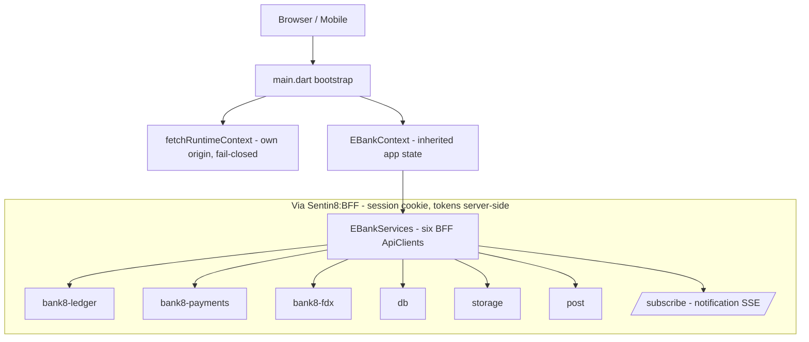

# Bank8:eBank - Customer Banking App (FDX Data Provider Side)

> Third-party Sentin8:App application. It is NOT part of the Sentin8 platform
> source tree; it uses the Sentin8 Flutter SDK (`sdk/flutter/sentin8`) as a
> published package. For wire-level detail read `DESIGN.md`; for the business
> view read `BUSINESS.md`.

## 1. Summary

eBank is the retail customer Flutter app of the Bank8 vertical: account
opening, balance and transaction viewing, internal transfers, external
payment history, statements, notifications, and the customer side of FDX data
sharing (consent review and revocation). It also carries a small staff admin
surface (instance overview, ledger product activation, FDX provider
administration). All backend access rides the Sentin8:BFF proxy - tokens
never reach the client.

## 2. Motivation

A digital bank needs a customer-facing channel that is *thin by design*: the
app can never be trusted to hold credentials or OAuth tokens, can never touch
databases or object storage, and must derive its entire runtime wiring from
the Sentin8:App instance it was installed for. eBank demonstrates the full
"customer + provider" side of open banking: the customer both banks and
grants/revokes consent for external FDX data recipients, while the financial
source of truth remains Bank8:Ledger/Bank8:Payments behind Bank8:FDX.

## 3. Architecture & High-Level Design

Components:

- **Bootstrap** - `fetchRuntimeContext()` (SDK) resolves the
  `AppRuntimeContext` from the app's own origin; unknown host or missing
  context fails closed to `BootstrapErrorPage`.
- **`EBankContext`** (`app_context.dart`) - the app's single `ChangeNotifier`
  state holder (`AppRuntimeContext` + `AuthProvider` + `EBankServices`) and
  customer provisioning (`ensureLedgerCustomer` - idempotent, 409-tolerant).
- **`EBankServices`** (`services.dart`) - typed BFF proxy clients:
  `ledger`, `payments`, `fdx`, `db`, `storage`, `post`; every call carries the
  BFF session cookie + `X-BFF-CSRF` + `x-sentin8-correlation-id`.
- **Hooks** (`hooks.dart`, `fdx_hooks.dart`) - `DataState<T>` adapters over
  the proxy clients (`AccountsHook`, `BalancesHook`, `TransactionsHook`,
  `PaymentsHook`, `PayeesHook`; FDX consents/providers/recipients).
- **Shell + routing** (`ebank_shell.dart`) - hash routing, sidebar, and the
  `NotificationSseClient` wiring (`/subscribe`, exponential reconnect).
- **Admin surface** (`pages/admin/`) - instance dashboard, ledger product
  activation/override, FDX provider administration.

## 4. Key Traits and Data Structures

- **`EBankServices`**: the six-client registry that names every backend the
  app may reach; there is deliberately no direct-service client.
- **`DataState<T>` hooks**: unified `loading / data / error` boundary for all
  pages; every backend read is expressed as a hook, not a `Future` in a widget.
- **`ensureLedgerCustomer`**: the post-sign-in provisioning step that links
  the authenticated subject to a Bank8:Ledger customer record (idempotent -
  replays are tolerated as `409`).
- **Transfer command shape**: a single `POST /v1/postings` call with
  `batch_id`, `idempotency_key`, and one `transfer` instruction - retries are
  safe by construction.
- **Branding via `AppRuntimeContext`**: display-name fallback chain
  (instance → org → slug), primary/accent colors, logo URLs, theme mode -
  applied through `sentin8ThemeForContext`.

## 5. Rationale, Trade-offs, and Alternatives

- **Custom context provider instead of generic auth provider at the root.**
  The app composes runtime context + auth + services + provisioning in one
  place so pages never reach for globals. Rejected: scattering provider
  lookups across pages (hard to test, easy to race at sign-in).
- **Hooks over Futures.** Every page renders from a `DataState`, so loading
  and error frames are uniform and testable. Rejected: ad-hoc `setState` +
  raw HTTP calls in widgets (inconsistent UX, untestable error paths).
- **Internal transfer through Ledger postings, external payments listed via
  Payments.** The transfer form posts a Ledger instruction directly (BFF
  proxy); the payments page lists payment/payee history. Keeping the two
  surfaces distinct mirrors the service split and avoids double entry.
- **Statements via signed URLs.** The app never buffers statement bytes
  itself; it requests a signed read URL from `storage` and hands it to the
  viewer. Rejected: proxying file bytes through the app (higher memory, no
  benefit).
- **SSE for notifications, not WebSocket.** Notifications are one-way;
  SSE with exponential reconnect is simpler and stateless.
- **Fail-closed bootstrap.** An app that cannot prove its instance identity
  is not allowed into any page. Rejected: degraded mode with defaults
  (would cross-tenant on a mis-hosted instance).

## 6. Internal Implementation & Invariants (Private Design)

- **Routing is hash-based inside the shell**; `url_router.dart` only
  re-exports SDK navigation helpers. Adding a page = shell route case +
  sidebar entry.
- **`ensureLedgerCustomer` runs once per session** and tolerates `409`
  (customer already exists) - it never blocks sign-in itself.
- **Transactions pagination** uses the ledger's `pageKey` cursor; `loadMore`
  appends. Balances and account detail share one refresh cycle on page enter.
- **The unread badge** is derived from `GET /proxy/post/v1/messages?unread`,
  then kept live by the SSE stream (`sentin8:notification.received` /
  `.read`).
- **Invariants:**
  - No page builds a service URL itself; all URLs come from the runtime
    context + `BffApiClient` path composition.
  - No OAuth token is ever stored, logged, or serialized in the client.
  - Customer tokens are env-locked; internal ledger accounts never appear in
    any customer-visible list (holder-scoped RLS upstream).
  - Every mutating call carries an idempotency key.
  - The FDX provider admin surface is staff-only; customers only ever view
    and revoke consents.

## 7. Unresolved Questions / Future Designs

- Push notifications are SSE-only; mobile push channels are a platform
  concern not yet exposed to apps.
- Statement download currently opens signed URLs in a new view; native
  PDF/preview embedding is UI polish not yet designed.
- External payment initiation (the counterpart to the existing payment
  history view) is intentionally absent from the page surface today.

---

**Architecture & Design:** bank8:ebank and its underlying concepts were designed by [Hamid Jahanzad](https://www.linkedin.com/in/hamidjahanzad/).
