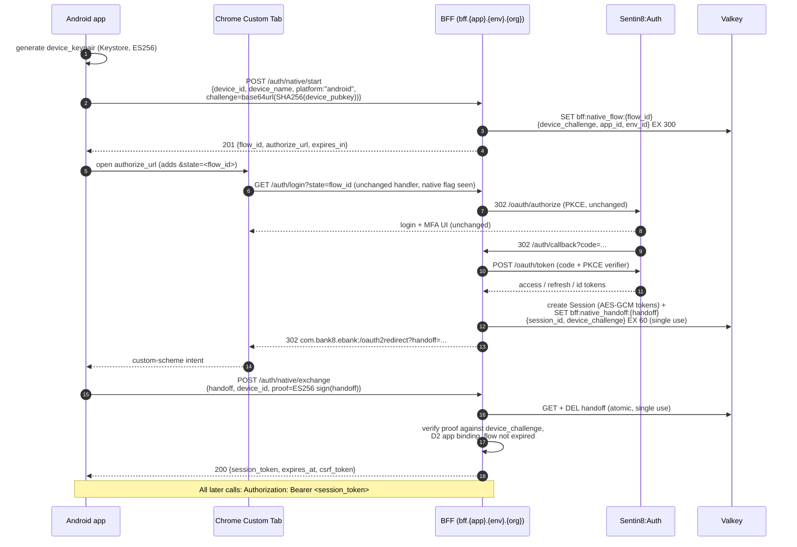

# WS1 — BFF Native Session Handoff (Option B)

Status: **Draft for review**
Repo: `sentin8-bff` (no `sentin8-auth` change)
Effort: **3.4 person-weeks** (§8 breakdown)
Blocks: WS4 (Android app), WS2 (push registration auth)
Related: [README.md](README.md), [02-flutter-sdk-platformization.md](02-flutter-sdk-platformization.md)

---

## 1. Problem

Sentin8:BFF authenticates clients **only** by the `bff-session` cookie.
A native app has no cookie jar shared with a browser, so it cannot acquire
that credential by itself. Three sub-problems fall out:

1. **Acquisition** — the OAuth dance must happen in a browser (Auth's UI is a
   hosted web page), but the result must land in the app.
2. **Transport** — every subsequent call must carry the session without a
   cookie.
3. **Lifetime** — a mobile session should survive app restarts and refresh
   without a user-visible re-login (biometric gate instead).

Current code, for reference:

| Concern | Today |
|---|---|
| Session read | `proxy.rs:147` → `extract_session_cookie()` → `Cookie: bff-session=` only |
| Duplication | **six** copies of the extractor: `proxy.rs:436` (`extract_session_cookie`), `handlers.rs:1871`, `subscribe/sse.rs:336`, `subscribe/manager.rs:157`, `ciba.rs:91`, `chat/ws.rs:238` |
| Session store | `Session` JSON in Valkey, `bff:session:{id}`, AES-256-GCM sealed tokens; **no migration needed to add fields** |
| TTL | `session_idle_ttl` / `session_absolute_ttl` (`SENTIN8_BFF_SESSION_IDLE_TTL`, `..._ABSOLUTE_TTL`; defaults in code: idle 7d, absolute 30d) |
| CSRF | `x-bff-csrf` compared to `sess.csrf_token`, only when `csrf_enabled && is_mutation(method)` |
| App binding | `Session::matches_application` (D2) — a session only works on the app instance that created it |
| Callback finish | 302 to `q.state` (the app frontend URL), `Set-Cookie: bff-session` |
| Refresh | `refresh_access_token()` pins `state.config.sentin8_auth_base_url` — the **platform** issuer |

---

## 2. Options considered

| Option | Mechanism | Verdict |
|---|---|---|
| **A. TWA / WebView cookie extraction** | Load `/auth/login` in a WebView, scrape `Set-Cookie` | **Rejected.** Requires a WebView (TWA cannot read its cookie jar), so it silently becomes a WebView app; `HttpOnly` scraping is fragile and defeats the point of `HttpOnly` |
| **B. Handoff + bearer session** *(chosen)* | BFF starts the flow, browser finishes it, BFF returns a one-time code to the app via custom scheme; app redeems code for an opaque session token | **Chosen.** No Auth change, no new OAuth client, no token on device |
| **C. RFC 8252 native client** | Register a `native` DCR client with `com.bank8.ebank:/oauth2redirect`, app does PKCE itself, receives tokens directly | **Rejected.** Puts access/refresh tokens in the app — violates the core `SECURITY.md` invariant. Also needs `application_type=native` client management that the shared DCR path defaults to `web` (`dcr.rs:864`) |
| **D. RFC 8628 device flow** | `POST /oauth/device` → user_code → poll token | **Rejected as primary.** Auth's implementation exists (`oauth.rs:10519`) and is deliberately CLI-scoped: `device_authorization` calls `authenticate_client(..., true, true)` and the grant is opt-in per client. Shipping tokens to the device is the same violation as C, plus a 15-minute `expires_in` and 5s polling that no bank customer should be asked to perform. Kept as a fallback for non-UI platforms only |

### Why B does not need an Auth change

- BFF remains the **only** OAuth client. It is already confidential and already
  owns the PKCE verifier lifecycle (`bff-pkce` cookie).
- The Auth-registered `redirect_uri` stays `https://{bff}/auth/callback`, so
  `native_apps::redirect_uri_matches` and its custom-scheme/loopback rules stay
  untouched.
- The custom-scheme redirect happens **after** the callback, issued by BFF, and
  is never presented to Auth as a `redirect_uri`.

---

## 3. Design

### 3.1 Flow



### 3.2 New endpoints

Both are unauthenticated at the transport level but fail closed on every
binding check.

#### `POST /auth/native/start`

```jsonc
// request
{
  "device_id": "6f1c...uuid",          // app-generated, stable per install
  "device_name": "Pixel 8",            // display only, sanitized
  "platform": "android",               // "android" | "ios"
  "challenge": "base64url(sha256(spki))" // PoP key, see 3.3
}
// 201
{
  "flow_id": "…",
  "authorize_url": "https://bff.bank8-ebank.{env}.{org}/auth/login?native=1&state=…",
  "expires_in": 300
}
```

Server side: store `{device_challenge, app_id, env_id, created_at}` at
`bff:native_flow:{flow_id}` with `EX 300`. `app_id` / `env_id` come from the
TLS-injected tenant headers on **this** request, so the flow is bound to the
instance the app called.

#### `POST /auth/native/exchange`

```jsonc
// request
{ "handoff": "…", "device_id": "…", "proof": "base64url(ES256(handoff))" }
// 200
{ "session_token": "…", "expires_at": 1767225600, "csrf_token": "…" }
```

Server side, in one atomic Valkey step (`GETDEL`): consume
`bff:native_handoff:{handoff}`; reject if absent (replay), if
`device_challenge` does not verify `proof`, or if `Session.application_id` does
not match the request's app id (D2). On success return the session id as
`session_token`.

### 3.3 Proof-of-possession

The handoff code alone would be a bearer credential stealable by any app on the
device that registers `com.bank8.ebank` (Android does not guarantee scheme
exclusivity). Bind it:

1. App generates an ES256 keypair on first run; private key in Android Keystore.
2. `challenge = base64url(SHA256(SPKI))` is sent at `start`.
3. The callback stores the challenge with the handoff.
4. `exchange` sends `proof = ES256_sign(handoff)`; the server verifies it against
   the stored challenge.

Consequence: an intercepted custom-scheme URL is useless without the device key.

### 3.4 Unified session extractor

Replace the six copies with **one** function in `session.rs`:

```rust
/// Resolve the caller's session id.
///
/// Precedence: `Authorization: Bearer` → `Cookie: bff-session`.
/// The bearer form is the native transport; the cookie form is the browser
/// transport. Both resolve to the same Valkey record, so every downstream
/// check (D2 app binding, CSRF, token decrypt, delegation) is shared.
pub fn extract_session_id(headers: &HeaderMap) -> Option<String>;
```

Call-site migration (all must use it, no exceptions):

| File | Site |
|---|---|
| `proxy.rs` | 147 |
| `handlers.rs` | 1368 (`/auth/session`), 1503 (`/bff/action`), 1642, 1721 (`/auth/refresh`) |
| `subscribe/sse.rs` | 113 |
| `subscribe/manager.rs` | 54, 134, 193 (push register), 226 (push delete) |
| `ciba.rs` | 213, 387 |
| `sessions.rs` | 43 (list/revoke) |
| `chat/ws.rs` | 82 |

**CSRF under bearer.** A bearer header is not ambient — the browser CSRF threat
does not exist. Rule: **the CSRF check applies to cookie-authenticated requests
only.** Bearer requests must still present `x-bff-csrf` when `csrf_enabled` and
the method mutates? **No** — require it for parity anyway in v1, then relax
behind a follow-up. Rationale: identical code path in v1 means the web and
native clients cannot diverge in a security-relevant branch, and the app can
trivially send the header (it receives `csrf_token` from `exchange`). Track the
relaxation as a follow-up with its own test.

### 3.5 `Session` additions (no migration)

`Session` is a Valkey JSON blob, so new fields are additive and
backward-compatible (older records deserialize with `#[serde(default)]`).

```rust
#[serde(default)] pub issuer: String,        // Auth issuer used at callback
#[serde(default)] pub transport: String,     // "cookie" | "bearer"
#[serde(default)] pub device_id: String,
#[serde(default)] pub device_name: String,
#[serde(default)] pub platform: String,
```

### 3.6 Fixing refresh for tenant issuers

`refresh_access_token()` and its two call sites (`proxy.rs:557`, `proxy.rs:664`)
hardcode `state.config.sentin8_auth_base_url`. The in-code comment already
admits the limitation: *"for tenant issuers the browser re-authenticates on
expiry instead"*. That is tolerable for a browser (a redirect is a redirect) and
**not** tolerable for an app (it means a full re-login, and a custom-scheme
round trip, whenever the access token expires).

Change: resolve the refresh issuer per session —

```text
session.issuer  (set at callback from the auth domain that issued the code)
  || state.config.sentin8_auth_base_url   (pre-existing sessions, platform)
```

This also fixes the browser path for tenant-issuer deployments. Include it in
WS1 because native sessions are long-lived and hit expiry routinely.

### 3.7 Sign-out and revocation

| Path | Behaviour |
|---|---|
| `POST /auth/sign-out` | destroy session; for bearer sessions also `DELETE` the push token (WS2). Cookie path additionally clears cookies (unchanged) |
| `DELETE /v1/auth/sessions/{id}` | unchanged, but must also delete `bff.push_tokens` for that session so a revoked device stops receiving notifications |
| Reaper | extend the existing `bff-session-reaper` Bus consumer (on `sentin8:auth:session:revoked`) to delete the push token as well |

---

## 4. Threat model

| Threat | Mitigation |
|---|---|
| Malicious app registers `com.bank8.ebank` and intercepts the handoff | ES256 proof bound to a per-install Keystore key (§3.3); handoff is single-use, 60s |
| Handoff replay | `GETDEL` — atomic consume, one redemption |
| Deep-link leak via logs / adb | handoff is a random 256-bit id, useless without device key; never logged |
| Session token theft from device storage | token sealed in Keystore with `setUserAuthenticationRequired(true)` behind biometric (WS4) |
| Session token replay from another device | optional v1.1: bind `device_id` in `Session` and reject mismatches; v1 relies on biometric gate + server-side revoke |
| Cross-app session replay (D2) | unchanged — `matches_application` still runs on every request |
| Bearer token in Android logs | transport is `Authorization` header only; the SDK's logger must redact it (WS3 test) |
| Open redirect via `state` | `authorize_url` is server-built; `state` is a server-generated flow id, never a caller URL. The callback's existing `q.state` redirect is **bypassed** when `native=1` (see §5) |
| CSRF | parity retained (bearer must send `x-bff-csrf` in v1) |

---

## 5. Callback change (the one modification to an existing handler)

`/auth/callback` currently ends with `302 Location: q.state`. For native flows:

```text
if q.state starts with "native:"  →  flow_id = remainder
    validate flow exists and not expired (fail closed: 400, no redirect)
    create session (existing code path, unchanged)
    mint handoff, store with device_challenge, EX 60
    302 Location: com.bank8.ebank:/oauth2redirect?handoff=…
else
    existing behaviour (Set-Cookie + 302 to q.state)
```

Two hard requirements:

1. The `native:` prefix must be the **only** accepted native state form, and the
   flow id must resolve in Valkey. No fallback to a caller-supplied URL.
2. A native flow must never also set the `bff-session` cookie. Separate branch,
   separate response builder, asserted by a test.

The `state` value is currently an opaque free-form string used as a redirect
target (`handlers.rs:110`, `287`). Introducing the `native:` namespace means the
existing open-redirect surface (`q.state` → `Location`) gains a branch that must
be **narrower**, not wider. WS8 pen-test targets exactly this.

---

## 6. Failure modes

| Condition | Response | Client behaviour |
|---|---|---|
| `flow_id` unknown/expired at callback | 400 page, no redirect | app shows "sign-in timed out, retry"; new `start` |
| `handoff` absent/expired/replayed at exchange | 401 | app returns to landing; new `start` |
| `proof` invalid | 401 (log as security event, do not reveal which check failed) | app returns to landing |
| app-id mismatch (D2) | 401 | app shows instance-mismatch error; **never** retries silently |
| Session expired mid-use | 401 from proxy | app attempts `POST /auth/refresh` (bearer) → on failure, biometric re-auth via `/auth/native/start` |
| Refresh token absent/expired | 400 | full re-auth |
| Valkey unavailable | 500 | app surfaces offline error frame |

---

## 7. Testing
| Test | Assertion |
|---|---|
| Bearer ↔ cookie parity | same session id, same `/proxy` result, for GET and mutation |
| Extractor unification | grep-based CI guard: no local `extract_cookie` definitions outside `session.rs` |
| Handoff single use | second `exchange` with the same code returns 401 |
| Proof required | correct handoff + wrong/no proof returns 401 |
| Flow binding | handoff created on app A rejected on app B (D2) |
| No cookie on native | callback with `native:` state emits zero `Set-Cookie` |
| Native state namespace | `state=native:unknown` → 400, no `Location` header |
| Refresh issuer | tenant-issuer session refreshes against the tenant issuer, not the platform one |
| Sign-out | bearer sign-out destroys session + push token; subsequent call is 401 |
| Web regression | full Playwright lifecycle suite green (unchanged code path) |

---

## 8. Task breakdown (3.4 pw)

| # | Task | Days |
|---|---|---|
| 1 | `extract_session_id` in `session.rs` + migrate 12 call sites + CI guard | 3 |
| 2 | `Session` field additions + backward-compat test with an old blob | 1 |
| 3 | `/auth/native/start` + flow store | 1.5 |
| 4 | `/auth/callback` native branch + handoff mint | 2 |
| 5 | `/auth/native/exchange` + ES256 proof verify | 2 |
| 6 | Refresh issuer resolution (proxy + refresh handler) | 2 |
| 7 | Sign-out / revoke / reaper push-token cleanup (with WS2) | 1.5 |
| 8 | Tests (§7) + `DESIGN.md` §4/§5/§8 updates | 3 |
| 9 | Security review of the `native:` state branch | 1 |
| **Total** | | **17 days ≈ 3.4 pw** |

---

## 9. Open questions

- O-A: Is device-bound session enforcement (`Session.device_id` check) required
  in v1, or is biometric + revoke sufficient? Current draft: v1.1.
- O-B: Should `exchange` also return the app's resolved runtime context, saving
  the app a bootstrap round trip? Cheap, but couples two concerns.
- O-C: Does the Play Store policy for financial apps impose a session-timeout
  ceiling (auto-lock) that conflicts with the 30-day absolute TTL? WS8 to
  confirm; may require a mobile-specific `session_absolute_ttl`.

---

## 10. Implementation status (2026-11-25)

**Landed in `sentin8-bff`.** `cargo build` clean, `cargo test` **73 passed / 0
failed**, clippy at the pre-existing baseline (19 findings, all in files this
work did not touch - verified by stashing the diff and re-running).

### What was built

| Item | Where |
|---|---|
| `extract_session_id` - the ONE credential reader (bearer → cookie) | `session.rs` |
| `bearer_session_token`, `extract_cookie`, `LEGACY_SESSION_COOKIE` | `session.rs` |
| `Session.issuer` / `.transport` / `.device_id` (all `#[serde(default)]`) | `session.rs` |
| `put_raw` / `take_raw` (`GETDEL`) for flow + handoff records | `session.rs` |
| `session_refresh_issuer` - per-session refresh authority | `proxy.rs` |
| Native CSRF rationale + `bearer_authenticated` logging | `proxy.rs` |
| `POST /auth/native/start`, `POST /auth/native/exchange` | `handlers.rs`, `server.rs` |
| `native:` state branch in `/auth/callback` (no session cookie) | `handlers.rs` |
| `native_session.rs` - flow/handoff records, device proof, state parsing | new module |

**All 13 inbound call sites migrated** - no endpoint still reads the cookie
directly. Six duplicate `extract_cookie` copies were deleted
(`proxy.rs`, `handlers.rs`, `ciba.rs`, `chat/ws.rs`, `subscribe/manager.rs`,
`subscribe/sse.rs`); the sole surviving definition is `session.rs` plus the
`handlers.rs` one used only for `bff-pkce`.

### Device proof

`p256` 0.13 (`ecdsa` feature) was already in the lockfile via `jsonwebtoken`, so
no new network fetch was needed. The proof is **two checks, both required**:

1. `sha256(presented SPKI) == challenge` recorded at `/start`
2. the signature over the handoff code verifies under that key

A failure returns a flat 401 - the response never reveals which half failed.

### Deliberate decisions recorded during implementation

- **CSRF is still required from bearer clients.** CSRF is an attack on ambient
  credentials, so a bearer header does not have that surface; requiring the
  header anyway keeps one security code path for web and native. The rationale
  and the relaxation path are in `proxy.rs` at the check itself.
- **A native flow never sets the session cookie.** The native branch is a
  separate response builder, not a conditional header, so it cannot
  accidentally mint a cookie.
- **`/auth/native/start` fails closed on the platform BFF** - there is no app
  instance to bind an enrollment to, so it returns 400 rather than minting an
  unbound flow.
- **The callback checks for a native state *before* consuming `q.state`** for
  the browser redirect. The `native:` prefix is the only accepted form, which
  keeps the existing `state`-as-redirect-target from widening.

### Still open

- `cargo test` covers the pure logic (extractor precedence, state parsing, proof
  verification, legacy JSON). The **HTTP round trip** - start → callback →
  exchange - needs a live Valkey and is not covered by an automated test yet;
  the integration suite has 19 passing tests but none exercise the handoff.
- Session revoke / push cleanup on sign-out is designed (§3.7) but the
  `bff.push_devices` table it depends on is WS2.
- The device-bound session check (O-A) remains v1.1; `Session.device_id` is
  recorded but not enforced.
