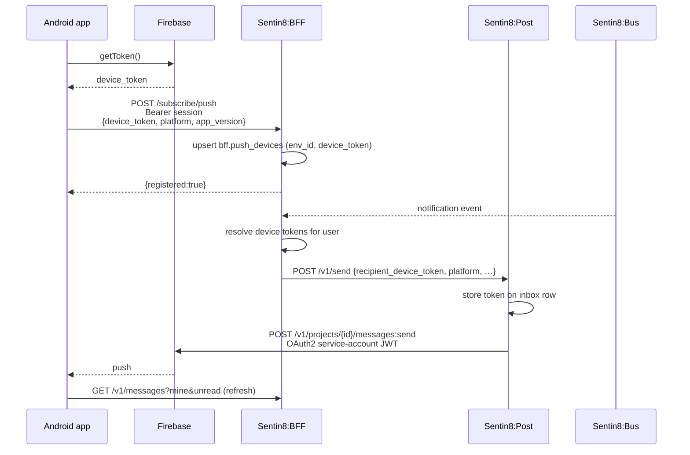

# WS2 — Push Notifications (FCM)

Status: **Draft for review**
Repos: `sentin8-post` (FCM adapter), `sentin8-bff` (token registry + bridge)
Effort: **3.4 person-weeks** (§8 breakdown)
Depends on: WS1 (bearer session — push registration must authenticate without a
cookie)
Blocks: nothing in MVP; can slip

---

## 1. Problem

Push looks wired but is not. Four independent breaks between the app and the
device:

| # | Break | Evidence |
|---|---|---|
| 1 | **Post's push handler is a stub** | `inbox_relay.rs:1214` — `"push" => tracing::info!(…, "push gateway stub: would send push notification")` |
| 2 | **The device token never reaches Post** | BFF sends `recipient_device_token` in the `/v1/send` body (`subscribe/push.rs:223`), but `post::SendMessageRequest` has **no such field** (`handlers.rs:200-220`). Serde silently drops it |
| 3 | **The token is not persisted** | `post.inbox` *has* a `recipient_device_token` column (`sql/init.sql:33`), but the `INSERT` (`handlers.rs:166-170`) lists 11 columns and omits it |
| 4 | **BFF keys tokens per session** | `UNIQUE (env_id, session_id)` (`sql/v2_push_sink.sql`) — a token dies when the session ends, so re-login loses push until the app re-registers |

Break 4 is survivable for web (a session and a tab are the same thing). On
mobile the user expects the token to belong to the **install**, not the login.

---

## 2. Target architecture



---

## 3. Schema change

New table in `bff` (keeping `push_tokens` for the legacy per-session path during
migration):

```sql
CREATE TABLE IF NOT EXISTS bff.push_devices (
    id            UUID PRIMARY KEY DEFAULT gen_random_uuid(),
    env_id        UUID NOT NULL,
    user_id       TEXT NOT NULL,          -- from the session that registered it
    device_id     TEXT NOT NULL,          -- app-generated stable install id (WS1)
    device_token  TEXT NOT NULL,          -- FCM registration token
    platform      TEXT NOT NULL CHECK (platform IN ('android','ios','web')),
    app_version   TEXT NOT NULL DEFAULT '',
    created_at    TIMESTAMPTZ NOT NULL DEFAULT now(),
    updated_at    TIMESTAMPTZ NOT NULL DEFAULT now(),
    -- one row per physical install; a rotated token updates in place
    UNIQUE (env_id, device_id),
    UNIQUE (env_id, device_token)
);
```

Notes:

- `UNIQUE (env_id, device_token)` also guards against two `device_id`s claiming
  the same token (happens after token rotation + reinstall).
- On `ON CONFLICT (env_id, device_id)`: update `device_token`, `user_id`,
  `updated_at`. This is what makes push survive logout/login on the same install.
- **Delete on sign-out of the last session for that user on that device**, not on
  every sign-out — otherwise multi-account usage breaks.
- RLS + `FORCE ROW LEVEL SECURITY` + the same `sentin8_set_tenant_context` pattern
  as `push_tokens`.
- FCM tokens are ~150-160 chars; `TEXT` is right (do not guess `VARCHAR(255)`).

`post.inbox.recipient_device_token` already exists — add `recipient_platform`.

---

## 4. BFF changes

| # | Change | Detail |
|---|---|---|
| 1 | New registration payload | `POST /subscribe/push` gains `{device_token, device_id, platform, app_version}`. Accept the old `{device_token}` shape and default `platform:"web"`, so the current web app keeps working |
| 2 | New table write | upsert `bff.push_devices` in addition to the legacy `push_tokens` row |
| 3 | Token resolution | the bridge resolves **all** device tokens for `recipient_user_id` in `env_id` (not just the current session's) — this is what delivers to a user who is signed in on a phone and a browser simultaneously |
| 4 | Bearer auth | `subscribe_push_register` / `_delete` currently call `extract_cookie` (`manager.rs:193`, `226`) — must use WS1's `extract_session_id` |
| 5 | Payload | include `recipient_device_token` **and** `recipient_platform` in the `/v1/send` body |
| 6 | Revocation | `DELETE /v1/auth/sessions/{id}` and the session reaper delete the matching `push_devices` row when it is the user's last session on that device |

Rate/shape guard: a single user with 10 devices must not fan out into 10 Post
sends per event. Batch: one `/v1/send` call carrying a device list, or one call
per device with distinct tokens. Choose the list form and extend
`SendMessageRequest` accordingly (one Post row, N deliveries).

---

## 5. Post changes (the real work)

### 5.1 Config

```text
SENTIN8_POST_FCM_ENABLED=true|false           # default false
SENTIN8_POST_FCM_PROJECT_ID=bank8-ebank-prod
SENTIN8_POST_FCM_CREDENTIALS=<secret-ref>     # service-account JSON, resolved
                                              # through Sentin8:Secrets
SENTIN8_POST_FCM_CANONICAL_IDS=true           # send canonical_ids back on error
```

Credentials must be a **secret reference**, never an inline JSON blob — the repo
already forbids plaintext secrets (see `SECURITY.md`).

### 5.2 Adapter

New module `src/push/fcm.rs`:

```rust
pub struct FcmAdapter {
    http: reqwest::Client,          // already a dependency (reqwest 0.12)
    project_id: String,
    credentials: ServiceAccount,    // client_email, private_key, token_uri
    token_cache: Mutex<Option<(String, Instant)>>,  // OAuth2 access token
}

impl FcmAdapter {
    /// Mint/cache a Google OAuth2 access token (JWT bearer grant, RS256).
    async fn access_token(&self) -> Result<String, String>;

    /// POST /v1/projects/{project}/messages:send
    pub async fn send(&self, token: &str, msg: &PushMessage) -> Result<(), PushError>;
}

pub enum PushError {
    /// 404 UNREGISTERED / 400 INVALID_ARGUMENT → delete the token, do not retry
    Unregistered,
    /// 429 / 5xx → retry with the existing backoff curve
    Retryable(String),
    /// anything else
    Fatal(String),
}
```

Dependencies: `jsonwebtoken` (or `ring`/`rsa`) for the service-account JWT.
`reqwest` is already present.

Message shape:

```jsonc
{
  "message": {
    "token": "<device_token>",
    "notification": { "title": "<subject>", "body": "<body>" },
    "data": { "message_id": "…", "type": "…", "category": "transaction" },
    "android": {
      "priority": "high",              // maps from post priority
      "notification": {
        "channel_id": "bank8_transactions",
        "click_action": "com.bank8.ebank.OPEN_MESSAGE"
      }
    }
  }
}
```

Priority mapping: `post.inbox.priority` `low|normal|high` → Android
`normal|high|high`. `category` → notification channel (see §6.3).

### 5.3 Inbox relay

- Persist `recipient_device_token` + `recipient_platform` on insert (§3).
- Replace the `"push"` stub arm with the adapter call.
- On `Unregistered`: delete the token from `bff.push_devices` **through the BFF's
  API** (Post must not write another service's tables — DBX rule), and mark the
  inbox row delivered so it is not retried.
- On `Retryable`: reuse the existing curve in `retry_delay_secs`
  (1s, 5s, 30s, 2min, 10min) and `retry_budget`.
- Idempotency: FCM `messages:send` has no idempotency key. Guard with the inbox
  row id in `data` so the app can de-duplicate a double delivery (the app keys
  its local notification on `message_id`).

### 5.4 Failure semantics

Push is **best effort**. An FCM outage must never:
- fail the `/v1/send` request (the inbox row is already written — the user still
  sees the message in-app),
- trigger a retry storm,
- block notification fan-out to SSE.

Explicit rule: the `/v1/send` response `status` stays `"queued"`; delivery status
is tracked on the inbox row, not surfaced to the caller.

---

## 6. Android app changes (WS4 dependency)

### 6.1 SDK choice

`firebase_messaging` (official FlutterFire). Requires:
- **one** `google-services.json`, for the single `com.bank8.ebank` package name
  (runtime enrollment means one APK serves every org — no per-org files)
- `google-services` Gradle plugin
- `POST_NOTIFICATIONS` runtime permission (Android 13+)

Because one Firebase project now fronts every tenant, the FCM payload must never
name the tenant or the org, and the notification text must never contain balances
or account numbers (§6.5). Cross-tenant isolation is enforced server-side: the
token registry is keyed by `env_id`, so a device enrolled to tenant A can never be
resolved for a tenant-B event.

Alternative: `flutter_local_notifications` alone cannot receive remote pushes;
it is only for local display. Use both: FCM delivers, local notifications renders
with the bank's channel/icon.

### 6.2 Token lifecycle

| Event | Action |
|---|---|
| App start (signed in) | `getToken()` → `POST /subscribe/push` (idempotent) |
| `onTokenRefresh` | `POST /subscribe/push` again (upsert) |
| Sign-in | register |
| Sign-out (last session) | `DELETE /subscribe/push` |
| `Unregistered` push error | BFF deletes the row; app re-registers on next start |

Token registration must be **fire-and-forget on a background retry**: a push
registration failure must never block the signed-in UI.

### 6.3 Notification channels

Three channels, created at first launch:

| Channel id | Name | Importance |
|---|---|---|
| `bank8_transactions` | Payments & transfers | `HIGH` (heads-up) |
| `bank8_security` | Security alerts | `HIGH`, `setShowBadge(true)`, no bypass-DND |
| `bank8_marketing` | Offers | `DEFAULT`, **opt-in only** |

Financial-app store policy point: security alerts must not be silenceable in a
way that hides fraud warnings — keep `bank8_security` visible in settings but
document the rationale in the data-safety form.

### 6.4 Deep link from notification

`click_action: com.bank8.ebank.OPEN_MESSAGE` + `data.message_id` → open
`/messages/{id}`. This requires WS5's routing work; until then, open
`/messages`.

### 6.5 Payload privacy

Never put account numbers, balances, or amounts in the notification body. The
lock screen is public. Send `"You have a new message"` + `message_id`; the app
fetches details after biometric unlock. This is a hard requirement — FCM
payloads transit Google infrastructure and are rendered on the lock screen.

---

## 7. Testing

| Test | Assertion |
|---|---|
| Adapter unit | OAuth2 token cached and refreshed before expiry |
| Adapter unit | 404 `UNREGISTERED` maps to `PushError::Unregistered` |
| Adapter unit | 429/500 maps to `Retryable`, no token deletion |
| Relay | `push` channel calls the adapter (no more stub) |
| Relay | device token persisted on the inbox row |
| Relay | adapter failure does not fail `/v1/send` |
| BFF | `POST /subscribe/push` accepts both payload shapes |
| BFF | token survives sign-out → sign-in on the same `device_id` |
| BFF | fan-out reaches every device of the user, not just the current session |
| BFF | session revoke deletes the device row when it was the last session |
| App integration | token registration retried after a forced network failure |
| Manual/device | notification arrives on a locked device; tap deep-links to the message |

FCM has a fake-server story (FCM HTTP v1 is plain REST): point the adapter base
URL at a local stub in tests. Do not mock `reqwest`.

---

## 8. Task breakdown (3.4 pw)

| # | Task | Days |
|---|---|---|
| 1 | `bff.push_devices` schema + RLS + registration payload back-compat | 2 |
| 2 | BFF fan-out by user (not session) + bearer auth on register/delete | 2 |
| 3 | BFF revoke/reaper integration | 1 |
| 4 | `SendMessageRequest` + inbox insert gain device token + platform | 1 |
| 5 | Post config + secret reference for FCM credentials | 1 |
| 6 | `push/fcm.rs`: OAuth2 JWT mint, token cache, send, error mapping | 4 |
| 7 | Relay integration + retry reuse + unregistered cleanup (via BFF API) | 2 |
| 8 | Tests (§7) | 3 |
| 9 | Docs: `sentin8-post/DESIGN.md` §10, `sentin8-bff/DESIGN.md` §10 | 1 |
| **Total** | | **17 days ≈ 3.4 pw** |

The FCM adapter's OAuth2 machinery (task 6) is the largest item and is the
reason this workstream is 3.4 pw rather than 2.5. If a Google service account
already exists in the org's secret store **and** a JWT-minting helper can be
reused from another service, task 6 can drop by ~1.5 days.

---

## 9. Open questions

- P1: **Resolved** — runtime enrollment (D6) means one Firebase project and one
  `google-services.json` for the single `com.bank8.ebank` package. Tenant
  isolation moves entirely server-side (`env_id`-keyed token registry).
- P2: Does Post get FCM credentials per env, or one platform-wide service
  account with per-env project IDs? The former is cleaner for isolation, the
  latter simpler to operate.
- P3: iOS is out of scope here, but the adapter should be shaped so an APNs
  branch is additive, not a rewrite.
