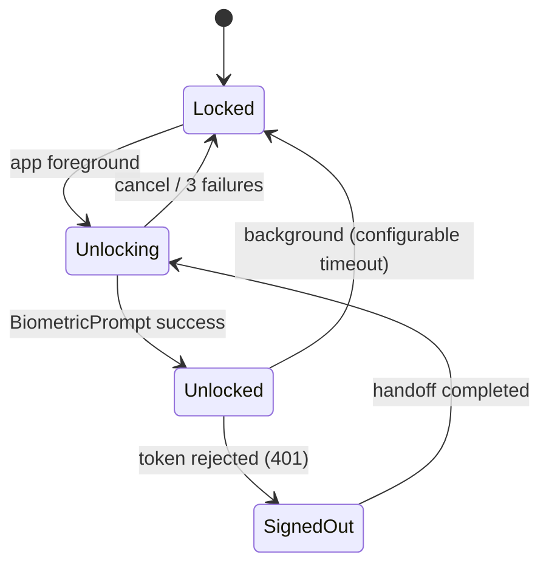

# WS0/WS4/WS5/WS6 — Android App

Status: **Draft for review**
Repo: `bank8-ebank`
Effort: **WS0 2.0 pw · WS4 3.4 pw · WS5 3.3 pw · WS6 1.5 pw = 10.2 pw**
Depends on: WS1 (bearer session), WS3 (SDK platformization)
Blocks: WS7 (release), WS2 integration

---

## 1. Baseline

Verified facts about the app **before** the port:

| Item | Value |
|---|---|
| `lib/` size | 4,843 lines / 30 files |
| Pages | 13 customer pages + 4 admin pages + 3 bootstrap/landing |
| Platform folders | **none** (`android/`, `ios/`, `macos/` all absent) |
| Web-only files in `lib/` | 4 — `main.dart`, `app_context.dart`, `pages/ebank_shell.dart`, `pages/messages_page.dart` |
| Web-only calls | `web.window.location.origin` (`main.dart:56`), `web.window.location.href` (`app_context.dart:47`), `web.window.onPopState` (`ebank_shell.dart:53`), `web.window.open` (`messages_page.dart:359`) |
| `DataTable` / `GridView` usage | **zero** — layout is `Row`/`Column`/`Wrap` only |
| Fixed widths | 3 meaningful (`ebank_shell.dart:203` sidebar `240`; `account_detail_page.dart:217` label `160`; `product_detail_page.dart:159` label `180`) |
| Nested `Scaffold` | every page returns its own `Scaffold`, nested inside the shell's `SingleChildScrollView` |
| Assets | `assets/logos/` contains only `.gitkeep` — **no launcher icon source** |
| Build | `make build` → `flutter build web`; `Dockerfile` → nginx on `build/web` |
| CI | `ci.yml` → `Sentin8/sentin8-ci/.github/workflows/flutter-app.yml@ci-v3` with `build-web: true`; **no Android input exists** |

### 1.1 Where the port actually stands (updated 2026-11-25)

The app **builds, installs and runs on an Android emulator**. Verified on a
Pixel-class AVD (API 37):

| Milestone | Status |
|---|---|
| `android/` platform folder | ✅ scaffolded, `com.bank8.ebank`, `minSdk 26` (D7) |
| `flutter build apk --debug` | ✅ 155 MB debug APK |
| Installed + launched on device | ✅ `Fully drawn com.bank8.ebank/.MainActivity: +1s384ms`, no crash |
| First-run enrollment screen | ✅ renders; input validated on device |
| Validation (`http://…`) | ✅ refused with "That is not a valid https address." |
| Fail-closed bootstrap | ✅ unresolvable host shows the error page, not a silent default |
| Web build still green | ✅ `✓ Built build/web` |
| App test suite | ✅ 28 pass |

What that does **not** mean: the app has no session yet, because there is no
running fleet and no BFF bearer-session endpoint (WS1). The device path stops at
"resolved origin → bootstrap attempted → host unreachable", which is the correct
fail-closed behaviour and the furthest point reachable without the backend.

The four web-only call sites are now behind `lib/platform/platform.dart`
(`appOrigin`, `redirectToUrl`, `openExternalUrl`, `browserBackEvents`, plus
`loadAppOrigin` / `saveAppOrigin` / `clearAppOrigin`). The native half persists
the origin to
`getApplicationSupportDirectory()/enrolled_origin.txt` — deliberately plain
storage, because Keystore sealing is WS9 and shipping a half-secured credential
store is worse than an obvious TODO.


The absence of tables and grids is the single biggest piece of good news in this
programme: the responsive pass is a shell rewrite plus a handful of row
reflows, not a table-to-card redesign.

---

## 2. WS0 — TWA stopgap (2 pw)

### Purpose

Get a verifiable Play Store presence in ~2 weeks without touching the Flutter
codebase, while WS1/WS3 run in parallel.

### What it is

A Trusted Web Activity: a thin Android shell that hosts
`https://bank8-ebank.{env}.{org}` in a real Chrome instance, full-screen, no
browser UI. It is *not* a WebView — it shares Chrome's cookie jar, so the
existing BFF session cookie works exactly as it does in the browser.

### Scope

| Task | Days |
|---|---|
| Bubblewrap project generated against the deployed eBank origin | 2 |
| Digital Asset Links (`assetlinks.json`) served from the app origin — **required**, or the app shows a URL bar | 1 |
| App Links for `/accounts`, `/messages` (so notification taps land in-app later) | 1 |
| Launcher icon + splash from brand assets (must be created; `assets/logos/` is empty) | 1 |
| Play Console: listing, screenshots, data-safety form, privacy policy URL | 2 |
| Internal testing track + a smoke checklist | 1 |
| Signing key + Play App Signing enrolment | 1 |
| **Total** | **9 days ≈ 2 pw** |

### Known limitations (document them in the listing)

- No push notifications (TWA cannot receive FCM).
- No biometric app-lock (unlock is the phone lock screen only).
- No offline mode.
- Statement downloads open in Chrome, not in-app.
- Play policy: financial apps in a TWA are acceptable but reviewers may ask why
  the web app is wrapped. Have the answer ready: "transitional; native client in
  development."

### Exit criteria

The TWA is **retired** when the native app reaches production. Do not maintain
both. Keep the TWA listing as an internal-track fallback only.

---

## 3. WS4 — Android target (3.4 pw)

### 3.1 Scaffold

```bash
flutter create --platforms=android --org com.bank8 --project-name ebank .
```

Then, deliberately:

| Setting | Value | Why |
|---|---|---|
| `applicationId` | `com.bank8.ebank` | stable identity; must not change after first publish |
| `minSdk` | **26** (D7) | `BiometricPrompt` + `setUserAuthenticationRequired` Keystore keys are reliable from 26; covers ~98% of devices |
| `targetSdk` | current Play requirement | must be within 1 year of latest |
| `compileSdk` | match Flutter 3.50's supported level | avoid plugin mismatch |
| `namespace` | `com.bank8.ebank` | Gradle requirement |
| Permissions | `INTERNET`, `POST_NOTIFICATIONS`, `USE_BIOMETRIC` | minimum set; **no** `READ_EXTERNAL_STORAGE` (use scoped storage / `ACTION_CREATE_DOCUMENT`) |
| Backup | `android:allowBackup="false"` + `dataExtractionRules` excluding the session | a bank app must not leak a Keystore-wrapped token into a cloud backup |
| Screenshots | `FLAG_SECURE` on screens showing balances | prevents the app appearing in the recents thumbnail |

`FLAG_SECURE` is a real requirement for a bank, not a nicety. Set via
`MethodChannel` or a small platform plugin on the app's own `FlutterActivity`.

### 3.2 Build variants — no per-org flavors

Runtime enrollment (D6) means **one APK, one `applicationId`, no tenant-specific
build flavor.** The origin is discovered at first run (see
[06-runtime-enrollment.md](06-runtime-enrollment.md)) and persisted. Keep exactly
two variants, both internal:

```gradle
buildTypes {
    debug   { applicationIdSuffix ".dev" }
    release { /* Play App Signing */ }
}
```

**Nothing tenant-specific may be compiled in** — no hostname, no OAuth client id,
no org name. WS8 verifies this by grepping the built artifact.

The earlier draft of this document specified per-org flavors with
`--dart-define=SENTIN8_HOST=…`. That approach is **withdrawn**: it multiplied the
release matrix per customer and still required the user to be told which build
to install.

### 3.3 Web-only call replacement (4 sites)

| File | Today | Replacement |
|---|---|---|
| `main.dart:56` | `web.window.location.origin` | the **stored enrollment origin**; if none, show the pairing screen (no default, no dart-define) |
| `app_context.dart:47` | `auth.onRedirect = (url) => web.window.location.href = url` | IO: hand to `NativeAuthHandler` (WS1 flow) |
| `ebank_shell.dart:53` | `web.window.onPopState.listen(...)` | `PopScope` + `NavigatorObserver`; the route is app state, not URL state |
| `messages_page.dart:359` | `web.window.open(url, '_blank')` | `url_launcher` → `launchUrl(uri, mode: LaunchMode.externalApplication)` |

`main.dart` is the important one: bootstrap can no longer assume a browser
origin **or** a compiled one. It reads the stored origin, and a missing origin is
not an error state — it is the first-run enrollment state.

### 3.4 Session storage + biometric lock



Implementation:

| Concern | Choice |
|---|---|
| Secure storage | `flutter_secure_storage` with `AndroidOptions(encryptedSharedPreferences: true)`. Under the hood: Keystore-backed AES key |
| Extra hardening | wrap the session token with a Keystore key created via `setUserAuthenticationRequired(true)`, `setInvalidatedByBiometricEnrollment(true)`. Rotating fingerprints must invalidate the key |
| Prompt | `local_auth` with `biometricOnly: false` (allow device credential fallback) and `sensitiveTransaction: true` for transfers |
| Lock triggers | app start, resume after `lockAfter` (default 60s) in background, and before any transfer confirmation |
| Failure policy | 3 biometric failures → fall back to device credential; 5 → sign out and clear storage |
| What is protected | the **session token**, not the UI. A UI-only gate is theatre — the token would still be readable on a rooted device |

Note: `encryptedSharedPreferences` plus `setUserAuthenticationRequired` can
conflict on some OEMs (the auth-bound key cannot wrap the whole prefs file).
The robust shape is: `flutter_secure_storage` holds the token; an auth-bound
Keystore key holds a short "unlock grant" that the app requires before it will
read the token from secure storage. Design the two layers explicitly; test on
Samsung + Pixel.

### 3.5 Handoff capture

```text
manifest intent-filter:
  <data android:scheme="com.bank8.ebank" android:host="oauth2redirect"/>
```

`app_links` (or `uni_links`) delivers the URI; the app extracts `handoff`, signs
it with the device key, and calls `/auth/native/exchange`. Because the deep link
is `https`-like in structure, add `android:autoVerify` only for `https` App
Links — a custom scheme cannot be verified, which is precisely why WS1 binds a
device proof.

### 3.6 WS4 task breakdown (3.4 pw)

| # | Task | Days |
|---|---|---|
| 1 | Scaffold, Gradle config, `minSdk` 26/`targetSdk`, `FLAG_SECURE`, backup rules | 3 |
| 2 | Replace the 4 web-only call sites | 2 |
| 3 | Handoff deep link + `NativeAuthHandler` wiring | 3 |
| 4 | Secure storage + Keystore auth-bound key | 3 |
| 5 | Biometric lock state machine + triggers + failure policy | 3 |
| 6 | Splash, launcher icon, theme from runtime context | 1 |
| 7 | Device matrix smoke (Pixel, Samsung, low-RAM, Android 26 and 15) | 2 |
| **Total** | | **17 days ≈ 3.4 pw** |

---

## 4. WS5 — Responsive UI (3.3 pw, revised down from an initial 5 pw estimate)

The original 5 pw assumed tables and grids. There are none. The real work:

### 4.1 Shell (the only structural change)

```text
today:  Row[ Container(width:240, sidebar) | VerticalDivider | Expanded(SingleChildScrollView(content)) ]
```

Replace with a breakpoint split:

| Width | Shell |
|---|---|
| `< 720` | `Scaffold(appBar: AppBar(title, actions: [bell]), drawer: Drawer(nav), bottomNavigationBar: NavigationBar(4 primary))` |
| `≥ 720` | current sidebar layout, unchanged |

Primary bottom-nav items: Dashboard, Accounts, Transfers, Messages. Everything
else (Products, Statements, Open banking, Admin) lives in the drawer. Do not put
6+ items in a bottom bar.

Also fix the scroll architecture: pages return their own `Scaffold`, nested
inside the shell's `SingleChildScrollView`. On mobile that gives a nested scroll
that fights the drawer and breaks `RefreshIndicator`. Change to: shell provides
`Scaffold`; pages return plain widgets with their own `ListView`/`CustomScrollView`.

### 4.2 Per-page work

| Page | Work | Days |
|---|---|---|
| `ebank_shell.dart` | breakpoint shell, drawer, bottom nav, scroll restructure | 4 |
| `account_detail_page.dart` | 9 `Row`s with `SizedBox(width:160)` label/value → `Wrap` or two-line layout | 1.5 |
| `product_detail_page.dart` | `SizedBox(width:180)` label/value → same | 1 |
| `admin_open_banking_page.dart` | 9 `Row`s — admin is tablet-first, but staff do use phones | 1.5 |
| `dashboard_page.dart` | 7 `Column`s, card stack — verify at 360dp | 1 |
| `product_catalog_page.dart`, `savings/lending_products_page.dart` | `Wrap` already present; verify 2→1 column | 1 |
| `transfer_page.dart` | form widths, keyboard-avoidance, amount field | 1 |
| `messages_page.dart`, `statements_page.dart`, `payment_list_page.dart`, `account_list_page.dart`, `open_banking_consent_dashboard_page.dart` | list padding, `SafeArea`, empty states | 2 |
| `admin/*` remaining | light pass | 1 |
| Global | `SafeArea`, `MediaQuery.textScaler` (large font), dark mode check at 360dp | 1.5 |
| **Total** | | **16.5 days ≈ 3.3 pw** |

### 4.3 Testing

- Widget tests at `Size(360, 800)`, `Size(411, 891)`, `Size(800, 1280)` for the
  shell and each page (golden tests where practical).
- `textScaler: TextScaler.linear(1.3)` pass — banks get accessibility complaints.
- Android "display size" and "font size" settings both cranked to max, on a real
  device.

---

## 5. WS6 — Native features (1.5 pw)

| Feature | Today | Native |
|---|---|---|
| Message links | `web.window.open(url,'_blank')` | `url_launcher`, external browser; **warn before leaving the app** with an interstitial for external links |
| Statement download | shows the signed URL in a `SnackBar` (`statements_page.dart:62-83`) | fetch the signed URL, then `ACTION_CREATE_DOCUMENT` to let the user pick a location; show progress; never auto-save |
| Statement share | none | `share_plus` with the signed URL (short-lived, so acceptable) |
| Pull to refresh | none | `RefreshIndicator` on list pages |
| Offline | none | cache last `DataState` per page; show a stale banner; disable mutations |
| Back button | browser popstate | `PopScope` — on a root page, confirm before exiting |
| Clipboard | none | copy account number / IBAN with a toast |
| Screenshot protection | none | `FLAG_SECURE` on balance-bearing screens |

Effort: **7 days ≈ 1.5 pw.**

---

## 6. App-side changes summary

| File | Change |
|---|---|
| `main.dart` | platform split; read the **stored enrollment origin** (no dart-define); no `window.location` |
| `app_context.dart` | `onRedirect` split (web: location; native: handoff) |
| `services.dart` | pass `sessionToken` to `BffApiClient` on native |
| `ebank_shell.dart` | breakpoint shell + drawer/bottom nav + scroll restructure |
| `messages_page.dart` | `url_launcher` |
| `statements_page.dart` | real download via `ACTION_CREATE_DOCUMENT` |
| `notification_sse.dart` | no change (SDK re-export) |
| `pubspec.yaml` | add `flutter_secure_storage`, `local_auth`, `url_launcher`, `share_plus`, `firebase_messaging`, `firebase_core`, `app_links`, `path_provider` |
| `android/` | new platform folder, `google-services.json`, `assetlinks.json`-verified App Links |
| `Makefile` | add `build-apk`, `build-aab`, `run-android` targets |
| `Dockerfile` | unchanged (web path untouched) |

**Unchanged on purpose:** `DESIGN.md` §3/§4 (data model, API surface) — the
mobile client reaches the same proxy endpoints. WS5 does update §2 (runtime
architecture) once both clients exist.

---

## 7. Testing strategy (extends `DESIGN.md` §9)

| Layer | New for Android |
|---|---|
| Widget | 3 viewport sizes; large-text pass; drawer/nav behaviour |
| Contract | unchanged (proxy paths identical) |
| Integration | handoff → session → accounts; biometric gate → unlock → data |
| Device | real Android matrix (see §3.4); emulator only for smoke |
| Security | no token in logs; `FLAG_SECURE` present; backup excludes session; root detection behaviour |
| Store | Play pre-launch report must be clean |

`integration_test/` runs on a real device/emulator through
`flutter test integration_test -d <device>`.

---

## 8. Risks

| Risk | Impact | Mitigation |
|---|---|---|
| OEM Keystore quirks break biometric unlock | High | Test on Samsung + Pixel + one low-end device early (day 3 of WS4); fall back to device credential + re-login |
| Play review rejects the financial-app data-safety form | Medium | Fill it from the WS8 privacy inventory, not ad hoc; TWA already establishes the listing |
| Enrollment requires a second app instance to exist | Medium | WS9 provisions it before WS4 integration; provisioning is a CLI verb, not a manual step |
| Manual enrollment sends a phishing-prone user to an attacker's instance | High | Bundled L2 trust anchors + explicit consent + biometric step-up before sign-up ([06](06-runtime-enrollment.md) §5.3); residual risk accepted by D10 |
| A platform-root rebrand bricks every enrolled install | High | Trust-anchor list is append-only; old + new roots coexist for one release ([05](05-release-and-compliance.md) §4) |
| Responsive pass regresses web layout | Medium | Breakpoint split keeps `≥720` on the current layout byte-for-byte; Playwright suite is the gate |
| Nested-`Scaffold` scroll change breaks web | Medium | Do it as its own commit, verify e2e, then build on it |

---

## 9. Local device runbook (verified)

Getting an emulator to stay alive in this environment cost more time than the
code did. Recorded so it is not rediscovered.

**The emulator is reaped when the terminal that launched it is cleaned up.**
`nohup … &` and `setsid … &` both survive the *command*, but the process dies
when the owning shell session ends. The only reliable shape is to run the
emulator in a **long-lived async terminal**:

```bash
export PATH="$HOME/Android/Sdk/platform-tools:$HOME/Android/Sdk/emulator:$PATH"
emulator -avd Medium_Phone_API_37.0 \
  -no-snapshot-save -no-boot-anim -no-audio \
  -no-window -gpu swiftshader_indirect     # headless; drop -no-window to watch
```

Then, in a separate shell:

```bash
adb wait-for-device
adb install -r build/app/outputs/flutter-apk/app-debug.apk
adb shell am start -n com.bank8.ebank/.MainActivity
adb logcat -d | grep -E 'FATAL|AndroidRuntime'      # expect empty
adb exec-out screencap -p > /tmp/ebank.png           # visual confirmation
```

Notes:

- `adb` is at `~/Android/Sdk/platform-tools/adb` and is **not** on `PATH` by
  default in this environment.
- `flutter devices` may list the emulator while `adb devices` shows nothing, or
  vice versa; trust `adb devices` for a device that is genuinely attached.
- `-no-window` plus `swiftshader_indirect` avoids GPU/display dependencies and is
  what the screenshots in this run were taken with.
- First Gradle run downloads CMake 3.22.1 (~1 min, one-off) and takes ~1.5 min;
  later runs are ~30 s.
- The debug APK is ~155 MB because it carries all ABIs. Use
  `--split-per-abi` or a release build when size matters.

**Driving the UI from `adb`** for smoke checks: `input tap X Y`,
`input text '...'`, `input keyevent 111` (dismiss keyboard, needed before tapping
a button the IME is covering), `input keyevent 67` (backspace), and
`exec-out screencap -p` to capture.
