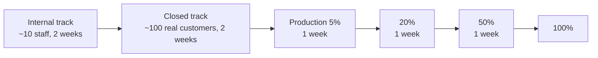

# WS7/WS8 — Release, CI, and Compliance

Status: **Draft for review**
Repos: `sentin8-ci` (workflow + generator), `bank8-ebank` (caller, signing,
checklists)
Effort: **WS7 1.5 pw · WS8 3.0 pw = 4.5 pw**
Depends on: WS4 (a buildable Android target), WS1/WS3 for the security review

---

## 1. CI today

The caller is **generated** — do not hand-edit `bank8-ebank/.github/workflows/ci.yml`:

```text
sentin8-ci/scripts/sync-ci.py:240-280   → emits the flutter caller body
  with:
    flutter-version: '3.47.2'
    sentin8-flutter-path: '../../sentin8/sentin8-flutter'
    build-web: true
```

The reusable lane `sentin8-ci/.github/workflows/flutter-app.yml` has exactly
four inputs (`flutter-version`, `sentin8-flutter-path`, `build-web`,
`flutter-test-platform`) and its steps are:

| Step | Blocking? |
|---|---|
| Checkout | — |
| Install Chromium (chrome-platform tests) | — |
| Clone `sentin8-flutter` at the pubspec path | — |
| Flutter toolchain (`subosito/flutter-action`) | — |
| `flutter pub get` | yes |
| `flutter analyze` | **advisory** (CICD-5 will flip it) |
| `dart format --set-exit-if-changed` | advisory |
| `flutter test` (chrome or vm per input) | yes |
| `flutter build web --no-tree-shake-icons` | yes when `build-web` |
| Upload web bundle artifact | — |

There is **no Android input and no JDK setup**. Any Android work must extend
both the reusable workflow and `sync-ci.py`, then regenerate every Flutter
caller (~20 repos) — otherwise the generator will silently revert hand edits.

---

## 2. WS7 — CI and release (1.5 pw)

### 2.1 New reusable input

```yaml
# flutter-app.yml
inputs:
  build-android:
    description: 'Run flutter build appbundle + apk'
    required: false
    default: false
    type: boolean
```

No `android-app-host` input is needed: runtime enrollment (D6) means the artifact
is tenant-agnostic, so **one AAB serves every customer org**.

Steps inserted after the web build:

```yaml
- name: Set up JDK 17
  if: ${{ inputs.build-android }}
  uses: actions/setup-java@... # temurin 17

- name: Setup Android SDK
  if: ${{ inputs.build-android }}
  uses: android-actions/setup-android@...

- name: Cache Gradle
  if: ${{ inputs.build-android }}
  uses: actions/cache@... # ~/.gradle/caches, ~/.gradle/wrapper

- name: Decode keystore
  if: ${{ inputs.build-android }}
  run: echo "$ANDROID_KEYSTORE_BASE64" | base64 -d > android/app/release.jks
  env: ANDROID_KEYSTORE_BASE64: ${{ secrets.ANDROID_KEYSTORE_BASE64 }}

- name: build appbundle
  if: ${{ inputs.build-android }}
  run: |
    flutter build appbundle --release \
      --dart-define=SENTIN8_VERSION=${{ github.sha }}
  env:
    ANDROID_KEYSTORE_PASSWORD: ${{ secrets.ANDROID_KEYSTORE_PASSWORD }}
    ANDROID_KEY_ALIAS: ${{ secrets.ANDROID_KEY_ALIAS }}
    ANDROID_KEY_PASSWORD: ${{ secrets.ANDROID_KEY_PASSWORD }}

- name: Upload AAB
  if: ${{ inputs.build-android }}
  uses: actions/upload-artifact@...
```

No tenant parameter appears anywhere in the build — that is the point of runtime
enrollment, and WS8 greps the artifact to prove nothing tenant-specific leaked in.

`sync-ci.py` change:

```python
build-android: {'true' if (r.path / 'android').is_dir() else 'false'}
```

Note this couples CI to a platform folder existing — which is exactly the signal
"this app has a native target". Good.

**Critical:** PRs to `sentin8-flutter` (WS3) must run the Android build too,
otherwise the conditional-import work is unverified until an app tries it. Add
`build-android: true` for the SDK repo specifically, or a dedicated
`sdk-platform-ci` job that compiles a minimal probe app for both targets.

### 2.2 Signing

| Item | Decision |
|---|---|
| Upload key | one per app — Play App Signing re-signs anyway. **One AAB serves all orgs** |
| Key storage | GitHub Environment secret, restricted to the release environment |
| `key.properties` | **never committed**; generated in CI from secrets |
| Play App Signing | enrol at first upload; the upload key can then be reset without changing the app identity |
| Key validity | 25+ years (Play requirement) |
| Rotation | document the Play "upload key reset" flow runbook |

`android/key.properties` must be in `.gitignore` — the repo's `.gitignore`
already covers `android/local.properties` but **not** `key.properties` or
`*.jks`. Add both.

### 2.3 Release lane

Current `release.yml` calls `repo-release.yml` with `repo-class: flutter`.
Extend with the same `build-android` input, and attach the AAB to the GitHub
Release. Play upload stays manual (internal track) until the pipeline is proven;
then `r0adkll/upload-google-play` behind a `workflow_dispatch` gate.

Do **not** auto-publish to production from a tag. A tag is a code signal; a
production rollout is a business decision with a staged rollout.

### 2.4 `Makefile` targets

```make
build-apk:   ## debug APK for device testing
build-aab:   ## release bundle (requires key.properties)
run-android: ## flutter run on the first attached device
```

Keep `build` = web (unchanged) so the Docker path and existing users are
unaffected.

### 2.5 WS7 task breakdown (1.5 pw)

| # | Task | Days |
|---|---|---|
| 1 | `flutter-app.yml` Android inputs + JDK/SDK/Gradle/keystore steps | 2 |
| 2 | `sync-ci.py` generator + regenerate all callers | 1 |
| 3 | SDK repo Android build job | 1 |
| 4 | `release.yml` / `repo-release.yml` AAB artifact | 1 |
| 5 | Keystore generation, Play App Signing enrolment, secrets | 1 |
| 6 | `Makefile` targets + `.gitignore` additions | 0.5 |
| 7 | Play Console: internal track, closed track, staged rollout config | 1 |
| **Total** | | **7.5 days ≈ 1.5 pw** |

---

## 3. WS8 — Security and compliance (3.0 pw)

### 3.1 `SECURITY_CHECKLIST.md` deltas

The current checklist asserts **"No OAuth access tokens on the Flutter client"**.
That remains true. But the mobile client *does* hold an opaque session token,
which the checklist does not mention. Add a section:

```markdown
## Mobile Session (Android)
- [ ] No OAuth access/refresh token is present in the app process or storage
- [ ] The native session token is stored only in Keystore-backed storage
- [ ] When biometric lock is enabled, the token is gated behind an
      auth-bound Keystore key
- [ ] The token never appears in logs (`flutter logs`, logcat, crash reports)
- [ ] `android:allowBackup="false"` and backup rules exclude app data
- [ ] `FLAG_SECURE` is set on balance-bearing screens
- [ ] Network security config permits only the tenant domain (no cleartext)
- [ ] Handoff codes are single-use and bound to a device proof (ES256)
- [ ] The enrollment origin records its assurance tier; `manual` origins are
      labelled as such in Settings and are **not** presented as verified
- [ ] Manual enrollment enforces the suffix allow-list and refuses redirects
- [ ] The L2 trust anchors are **compiled in**, never fetched from an unverified host
- [ ] The trust-anchor list is append-only across releases (no root removed while installs point at it)
- [ ] Custom-domain hosts are refused by manual entry with a QR/Link pointer
- [ ] `manual` tier requires biometric confirmation before the sign-up form
- [ ] Sign-out clears the token, the push registration, and the cookie jar
- [ ] Session revoke (other device) removes the push token server-side
```

### 3.2 `SECURITY.md` deltas

Update the trust-boundary statement: "the client holds an opaque session
credential (cookie on web, bearer token on native), never an OAuth token." One
sentence, but it must be accurate — this is the invariant the whole auth design
protects.

### 3.3 Network security

`res/xml/network_security_config.xml`:

```xml
<network-security-config>
    <base-config cleartextTrafficPermitted="false">
        <trust-anchors>
            <certificates src="system"/>
        </trust-anchors>
    </base-config>
    <!-- dev only -->
    <debug-overrides>
        <trust-anchors>
            <certificates src="user"/>
        </trust-anchors>
    </debug-overrides>
</network-security-config>
```

Certificate pinning: **evaluate, probably defer.** Pin sprawl at a bank breaks
sign-in during certificate rotation and, with the TLS proxy terminating on a
public CA, the pin would have to be maintained per environment. If required by
policy, pin the leaf and document the rotation runbook — 1 extra day.

### 3.4 Pen-test scope (the deliverable that matters)

Commission a focused test on:

| Area | What to try |
|---|---|
| Handoff | Replay a custom-scheme URL; intercept it with a hostile app; replay on another device; reuse after 60s |
| **Enrollment** | Manual host entry: bypass the suffix allow-list (L2) via userinfo / trailing dot / punycode tricks; force a redirect (L3); point at a staff-mode instance (L5); confirm the consent screen (L6) cannot be skipped; verify the `manual` tier genuinely forces biometric before sign-up |
| Proof bypass | Call `/auth/native/exchange` without `proof`; with a proof from a different key |
| `native:` state | Craft `/auth/callback?state=native:...` with an unknown flow id; attempt open redirect through `state` |
| Bearer surface | Use a bearer token with no CSRF header; from another app id (D2) |
| Token at rest | `adb backup` / root read attempts; check secure-storage and Keystore config |
| Logs | Grep logcat and any crash reporter for the session token |
| Biometric bypass | Disable biometrics after enrolment (key invalidation); retry loop |
| Push payload | Read a notification payload from FCM's debug channel; confirm no PII |

Estimated: **5 days of external tester time + 2 days internal fix buffer.**

### 3.5 Play Store compliance

| Item | Note |
|---|---|
| Data safety form | Enumerate: session token (app functionality, not shared), device token (app functionality, shared with Google/FCM), no location, no contacts, biometrics used locally (never transmitted). **Biometrics are not "collected"** — say so explicitly |
| Financial services declaration | Answer the Play financial-services questionnaire; the TWA listing gives precedent |
| Privacy policy URL | Must cover push + biometrics, not just web |
| Account deletion | **Confirmed requirement.** Public sign-up is enabled (D9), so users can create an account in-app and Play requires an in-app deletion path. eBank has none today, and **Ledger has no delete or close endpoint** — `/v1/customers` exposes only create / list / get / update / link-auth (`ledger/src/server.rs:332-339, 622`). See the note below |
| — | **Regulatory constraint:** hard-deleting financial records is generally not permitted (retention rules, AML/audit). The compliant shape is **account closure + PII anonymisation**, not a row delete. Design it as a closure state machine, and say so in the data-safety form ("data deleted or anonymised") |
| — | Minimal viable path for v1: close accounts, revoke Auth sessions, anonymise the customer record's PII, retain the ledger entries for the statutory period. That still needs a new Ledger endpoint |
| Target API level | within 1 year of latest at each release |
| 16 KB page size | required for new apps targeting Android 15+ — check Flutter/plugin compatibility at WS4 kickoff |
| Pre-launch report | must be clean (crashes, accessibility, and **no PII in screenshots**) |

### 3.6 WS8 task breakdown (3.0 pw)

| # | Task | Days |
|---|---|---|
| 1 | `SECURITY_CHECKLIST.md` + `SECURITY.md` updates | 1 |
| 2 | Network security config, backup rules, `FLAG_SECURE` verification | 1.5 |
| 3 | Log-redaction audit (SDK + app) | 1 |
| 4 | External pen test (scheduling + findings triage) | 2 |
| 5 | Fix pen-test findings | 2 |
| 6 | Play data-safety form + financial declaration + privacy policy | 1.5 |
| 7 | Account closure + anonymisation — **required by D9**; needs a new Ledger endpoint (none exists today) + Auth session revocation + Play data-safety wording | 5 |
| 8 | Pre-launch report triage + staged rollout plan | 1 |
| **Total** | | **15 days ≈ 3.0 pw** |

---

## 4. Rollout plan



| Gate | Requirement |
|---|---|
| Internal → Closed | Pen test closed, crash-free sessions > 99.5%, biometric unlock success > 95% on the device matrix |
| Closed → 5% | Play pre-launch report clean, no P1 security findings, push delivery > 95%, **and manual-tier sign-up volume reviewed** — if material, pull PB-1 (signed runtime context) forward before this gate |
| 5% → 20% | No rise in sign-in failures; BFF 5xx flat |
| Each step | Rollback = halt the staged rollout (Play supports halting, not reverting) |

Two release-process rules that are easy to miss:

- **The L2 trust-anchor list is append-only across releases** (D11). If the
  platform root is ever rebranded or migrated, ship a build that accepts both old
  and new roots for at least one release. Removing a root from a shipped build
  silently bricks every install pointed at it — there is no recovery path,
  because a bricked app cannot be told where to look.
- **Never auto-publish to production from a tag.** A tag is a code signal; a
  rollout percentage is a business decision.

Kill switch: the mobile client must be disable-able server-side. Cheapest
implementation is a runtime-context feature flag (the SDK already reads
`feature_flags`), returning a "please update" page. Plan it — banks need it.

Add a **manual-tier telemetry counter**: how many installs enrolled without a
verified link, and how many of those used self-service sign-up. It is the only
evidence that would justify promoting PB-1 from the backlog.

---

## 5. Documentation updates required

| File | Change |
|---|---|
| `bank8-ebank/DESIGN.md` | §2 runtime architecture (two clients), §5 auth (session transport), §6 failure modes (mobile), §9 testing (device matrix) |
| `bank8-ebank/README.md` | build instructions (`make build-aab`); note that one AAB serves all orgs (runtime enrollment) |
| `bank8-ebank/SECURITY.md` | trust boundary sentence, mobile section |
| `bank8-ebank/SECURITY_CHECKLIST.md` | §3.1 above |
| `bank8-ebank/service-registration.json` | note the mobile consumer; consider a `platforms` field |
| `sentin8-bff/DESIGN.md` | §4 API surface (native endpoints), §5 auth transport, §8 invariants |
| `sentin8-flutter/README.md` | correct the false "native + web" claim → describe the conditional-import contract |
| `sentin8-flutter/DESIGN.md` | §2 is aspirational today; make it true or mark it planned |
| `sentin8-post/DESIGN.md` | §10 push adapter is real, not a stub |
| `sentin8-ci/DESIGN.md` | §2.1 flutter lane gains an Android input |

Doc honesty point: `sentin8-flutter/README.md` currently claims native support
that does not exist, and `DESIGN.md` claims conditional imports that are not
there. Those are the two misleading statements that let this gap survive — fix
them in WS3, not at the end.
