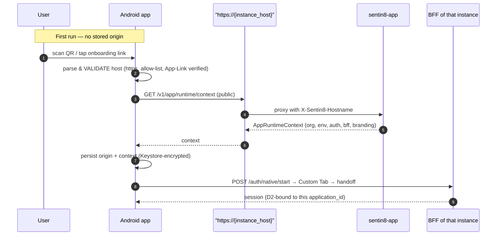
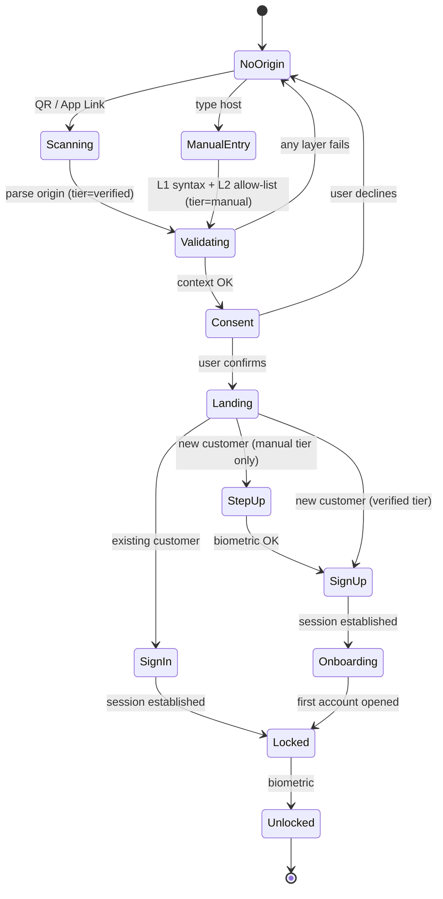

# WS9 — Runtime Enrollment + Separate App Instance

Status: **Draft for review**
Repos: `sentin8-app` / `sentin8-sys` (discovery gap), `bank8-ebank` (registration,
pairing UI), `sentin8-cli` (provisioning)
Effort: **4.3 person-weeks** (§8 breakdown)
Supersedes: the per-org build-flavor approach (O1 in [README.md](README.md))
Depends on: WS1 (the session is bound to the instance it was created for)
Blocks: WS4 (the app cannot bootstrap without an origin)

---

## 1. Decisions this doc implements

| Decision | Consequence |
|---|---|
| **Runtime enrollment** (not per-org flavors) | **One APK** for all customers. The tenant origin is discovered/stored at first run, not compiled in |
| **`minSdk` 26** | Biometric prompt + auth-bound Keystore keys; ~98% device coverage |
| **Separate app instance** (`bank8-ebank-mobile`) | Own hostname, OAuth client, scope whitelist and listing — isolated from the web app |
| **Config mirrors the web instance** (D8) | Customer mode: **`auth_domain` left empty**, `allow_signup: true`. Not a staff-auth instance |
| **Public sign-up enabled** (D9) | Account opening is in scope on mobile; the sign-up journey must work in the Custom Tab |

D8 is load-bearing, not cosmetic: `auth_domain = ''` is what makes the instance
*discoverable by sign-up* (§3.4) and what enables the BFF's fail-open customer
group auto-add (§3.5). Setting `auth_url` at provisioning silently disables both.

The combination is stronger than it looks: a separate instance means the mobile
session is bound by D2 to a **different `application_id`** than the web app, so a
token from one surface is rejected on the other by construction.

---

## 2. The blocker: there is no public discovery surface

Runtime enrollment requires answering *"given something the user has, which
hostname do I call?"* Today no public API does that. Verified:

| Surface | Gate | Usable by a client? |
|---|---|---|
| `GET /v1/app/runtime/context` | **public** (by design — pre-login bootstrap) | ✅ but **requires the hostname already** |
| `GET /v1/app/instances/customer-mode` | `verify_token` + `sentin8:app:instances:read`, **M2M only** (`handlers.rs:1665`) | ❌ |
| `GET /v1/app/store/listings`, `.../listings/{id}` | `verify_token` + `sentin8:app:store:read` | ❌ |
| `GET /v1/app/setup/{id}/status` | authenticated | ❌ |

Also relevant (`handlers.rs:1683-1689`): `customer_mode_instances` only returns
rows where `allow_signup = true AND status = 'active' AND auth_domain = ''` — it
is a *sign-up entry* helper for platform surfaces, not a general directory.

**So enrollment cannot be "type your bank name → we find it."** That would
require a new public endpoint, and a public directory of tenant hostnames is
itself an enumeration surface a bank should not ship.

### Chosen enrollment path

**Pairing artifact → hostname → existing public bootstrap.**



Two accepted inputs, in order of preference (D10: **both are offered**):

| # | Input | Assurance | How the origin is trusted |
|---|---|---|---|
| 1 | **QR code / `https://` App Link** carrying `https://{host}/enroll` | **verified** | Android verifies domain ownership via `assetlinks.json` + `autoVerify`; the bank printed/served the URL |
| 2 | **Manual host entry** (advanced / fallback) | **unverified** | Nothing verifies it. Trust is *informed consent*, not proof — see §5.3 |

Manual entry is offered because real deployments need it: a customer on a
brand-new instance, an emailed link that does not survive the mail client, a
corporate device with the camera disabled. Excluding it pushes those users to
phone support, which is a worse security surface than a well-designed form.

But it cannot be made safe by validation, and the design must not pretend
otherwise:

- `AppRuntimeContext` is **unsigned** — no HMAC, no JWS (`sentin8-app/src/handlers.rs:49-100`). Any host can return a perfectly-shaped response.
- There is **no public pre-login posture endpoint**. `GET /v1/app-instance/auth-mode` returns `application_id`, `org_id`, `instance_name`, `group_gate` and `allow_signup` — exactly the fields that would let the app check a host — but it requires authentication (`sentin8-sys/src/handlers.rs:4482`), so the app cannot call it before sign-in.
- A public directory of tenant hostnames is itself an enumeration surface, and is rejected here for the same reason as §2.

So manual entry is classified by **assurance tier**, and the tier is shown to the
user and recorded with the stored origin (§5.3).

Explicitly **rejected**: inferring the host from an email domain, an org name, a
subdomain guess, or `customer_mode_instances`. Each either needs a public
directory or silently invites phishing.

### Why the QR path actually works

`/v1/app/runtime/context` is registered on the **top-level** web router
(`sentin8-web/src/main.rs:239`), *before* the multi-app static handler, and its
doc comment states the intent:

> PUBLIC, pre-login surface: this is the bootstrap call every app makes before
> any user signs in — the Flutter SDK holds no token yet […] A bearer-token +
> Shield gate here would 401 every app bootstrap.

It forwards `x-sentin8-*` and `host` to `sentin8-app`, which resolves the
instance by `hostname` / `subdomain` (`handlers.rs:1825-1869`). So any host that
reaches the web service can bootstrap — no web bundle is required, because the
route never touches `resolve_web_root()` (that 404 path only affects *static*
serving, `main.rs:386`).

---

## 3. The separate instance

### 3.1 What it is

A second row in `sys.app_instances` with `app_slug = 'bank8-ebank-mobile'`.
Everything tenant-scoped derives from it:

| Property | Value | Source |
|---|---|---|
| Hostname | `bank8-ebank-mobile.{env_slug}.{org_domain}` | `handlers.rs:1065` — `{app_slug}.{env_slug}.{org_domain}` |
| BFF hostname | `bff.bank8-ebank-mobile.{env_slug}.{org_domain}` | `bff.{hostname}` |
| Cookie domain | `.bank8-ebank-mobile.{env_slug}.{org_domain}` | `session::app_cookie_domain_for_host` strips the `bff.` label |
| OAuth client | its own `oauth_client_id` | `sys.app_instances.oauth_client_id` |
| D2 binding | its own `application_id` | `Session.application_id`, checked by `matches_application` |
| Scope whitelist | its own `allowed_scopes` / `allowed_services` | `sys.app_instances` |
| Listing | its own `store_listings` row | `app.store_listings` |

`hostname` is `UNIQUE`, so the mobile instance cannot collide with web. And
because the cookie domain is instance-scoped, web and mobile sessions never
share a jar — which is why this decision is *safer* than reusing one instance.

### 3.2 Mobile scope whitelist

Public sign-up (D9) means **account opening is in scope**, so the whitelist keeps
every scope a first-run customer needs — but still drops the *staff* scopes:

```text
the whole of the web whitelist, minus:
  drop: bank8:ledger:accounts:write:any   ← staff onboarding assist
  drop: openfin8:ca:admin                ← provider administration

and, if genuinely unused by any page:
  drop: db:data:read, db:data:write
```

Keep `bank8:ledger:accounts:write` — that is what opens an account
(`accounts.rs:120`) — and keep `bank8:ledger:products:read` for the product
catalog. Do **not** narrow the customer scopes: sign-up runs
`ensureLedgerCustomer()` → `POST /v1/customers`, which is gated on
`bank8:ledger:accounts:write` (`ledger/handlers/customers.rs:75`), followed by
`POST /v1/accounts` from `product_detail_page.dart:74`.

On `db:data:*`: `services.dart:39` constructs a `db` client, but no page calls
it (verified: zero `.db.` call sites in `lib/`). Dropping it is safe and shrinks
the blast radius. Verify again at implementation time before relying on it.

Note `bff8/scope_whitelist.rs` also lists `"fdx"` in `allowed_services` while
the client calls `openfin8-ca` (`services.dart`). That mismatch is pre-existing;
the mobile instance should declare the service name the client actually calls.

Rationale for the narrowed set: a customer phone has no business holding
`openfin8:ca:admin`. Scope whitelisting per instance makes that true *by
construction* rather than by UI concealment. `isAdmin` gating in `ebank_shell`
becomes unnecessary on mobile — keep it as defence in depth.

### 3.3 Registration

`service-registration.json` already holds an `apps[]` array (verified: 1 entry,
`ebank`), and `register_apps_from_dir` iterates it
(`vertical_registry.rs:3057`). Adding a second entry is supported:

```jsonc
"apps": [
  { "slug": "ebank", "web_dir": "build/web", "listing": { /* unchanged */ } },
  {
    "slug": "ebank-mobile",
    "web_dir": "",                       // no web bundle
    "listing": {
      "app_name": "Bank8:eBank Mobile",
      "app_slug": "bank8-ebank-mobile",
      "description": "Bank8 eBank on Android.",
      "backend_url": "",
      "supports_dcr": true,
      "visibility": "public",
      "status": "published",
      "oauth_defaults": {
        "grant_types": ["authorization_code", "refresh_token"],
        "response_types": ["code"],
        "token_endpoint_auth_method": "none",
        "scopes": [ /* the §3.2 subset */ ],
        "consent_required": false
      }
    }
  }
]
```

Caveat to verify at implementation time: registration writes a capture:app_dir
key from `app_dir.join(web_dir)` (`vertical_registry.rs:3225-3241`) without
checking existence, so `web_dir: ""` should register cleanly and simply never be
served statically. That is the desired outcome for a mobile-only instance — but
confirm with a test, and confirm `GET /` on the mobile host 404s rather than
serving a sibling app.

### 3.4 Sign-up discoverability of the instance

A public sign-up only lands the new user in the mobile app's group if the
instance is **discoverable by Auth's sign-up closure**:

```sql
-- sentin8-app/src/handlers.rs:1683-1689 (customer_mode_instances)
WHERE env_id = $1
  AND allow_signup = true
  AND status = 'active'
  AND COALESCE(auth_domain, '') = ''
```

`auto_add_to_app_groups` (`sentin8-auth/src/handlers.rs:798`) calls this owner API
through the `sentin8:auth` workload certificate and joins the user to every
returned instance's `sentin8:app:{instance_id}` group. Consequences:

- The mobile instance **must** be `allow_signup = true`, `status = 'active'`, and
  **`auth_domain` empty**. All three are satisfied by provisioning without
  `auth_url` (§4).
- Because the web and mobile instances are *both* customer-mode, a sign-up in the
  same env joins the user to **both** groups. That is correct and desirable: one
  customer identity, two surfaces, each with its own `application_id` session
  binding.
- `sentin8:app:instances:read` and the platform CA must be available to the Auth
  service, or the closure silently provisions nothing. This is best-effort by
  design and logged, never fatal to sign-up — which means it can fail quietly.
  Add an operational check (§7).

### 3.5 The BFF app-group gate and existing customers

The BFF's F-A gate (`sentin8-bff/src/handlers.rs:888`) runs on **every** sign-in:

| Situation | Outcome |
|---|---|
| Group not provisioned in the token's auth env | **allow** + warning (`handlers.rs:975`) |
| User is a member | allow |
| Not a member, `auth_domain` **empty** | customer auto-add via the `bff-provision` workload (`auth_provision.rs:37`), then allow |
| Not a member, `auth_domain` **set** | **deny** — `not a member of this app ({group})` |
| `bff-provision` certificate unavailable | **deny** (fail-closed, `handlers.rs:1008`) |

This is what makes D8 mandatory rather than tidy, and it is also why an existing
**web** customer can use the mobile app without an admin step: their first
mobile sign-in hits the empty-`auth_domain` branch and the BFF adds them to the
mobile instance group on the spot.

Two operational dependencies to verify before rollout:

1. `bff-provision` can obtain its workload certificate from the platform CA.
   Without it the auto-add silently degrades to a hard denial for every
   non-member.
2. The gate's group lookup runs inside a tenant-context transaction. If context
   initialization regresses, `group_exists` returns false and the gate
   **fails open** (`handlers.rs:975`) — a permissive failure, not a lockout. Worth
   an assertion in WS8.

`token_endpoint_auth_method: "none"` is already what the web listing uses; it
refers to the **BFF's** DCR client, not to a public mobile client. Under WS1 the
app never contacts Auth directly, so nothing about this changes.

---

## 4. Provisioning (ops)

`POST /v1/app/setup` already does everything needed, authenticated with
`sentin8:app:instances:write` (`handlers.rs:955`):

```jsonc
// POST /v1/app/setup?target_env_id={env}
{
  "listing_id": "<bank8-ebank-mobile listing>",
  "channel": "stable",
  "instance_name": "Acme eBank Mobile",
  "instance_description": "Acme Bank mobile app",
  // NO "auth_url" - see the warning below
  "allow_signup": true
}
```

> **Do not pass `auth_url`.** It sets `auth_domain` on the instance, which turns
> the instance into a *staff-auth* instance and breaks public sign-up in two
> independent places:
>
> 1. `customer_mode_instances` filters `AND COALESCE(auth_domain, '') = ''`
>    (`sentin8-app/src/handlers.rs:1686-1689`). A pinned instance therefore never
>    appears to Auth's sign-up closure, so a new customer is auto-added to **no**
>    app group.
> 2. The BFF's F-A customer auto-add is gated on `inst.auth_domain.is_empty()`
>    (`sentin8-bff/src/handlers.rs:986`). With a pinned auth domain the branch
>    falls through to `Err("not a member of this app")` — every customer is locked
>    out at their own first sign-in.
>
> The web `bank8-ebank` instance is installed **without** `auth_url`
> (`bank8-e2e/tests/global-setup.ts:221`), which is why customer sign-up works
> there. "Follow the web instance" (D8) means the same here.

It creates the instance (`status: provisioning`), derives `hostname` and
`sentin8_bff_hostname`, and calls Sys to derive the TLS mappings
(`_derive_sentin8_tls_mappings`). Then `GET /v1/app/setup/{id}/status` until
`active`.

Wrap this in a CLI verb rather than hand-run curl:

```text
sentin8-cli app provision-mobile --env <env> --org <org>
```

The verb must **never** accept `--auth-url`; it exists for the customer instance
only. If a future staff variant needs it, that is a different verb with different
tests.

Idempotency requirement: re-running must return the existing instance, not
create a second one. The instance is keyed by `(env_id, app_slug)` in practice
(hostname is unique and derives from the slug), so the verb should look up
first.

**Enrollment artifact generation.** For each provisioned instance, emit the QR
payload and the App Link:

```text
https://bank8-ebank-mobile.{env}.{org}/enroll
```

Serve it from `bank8-site` or the org's onboarding email. The QR content is the
bare URL — the app strips `/enroll` and uses the origin. Keeping it a plain
`https` URL (not a custom scheme) is what lets Android verify the domain via
App Links.

---

## 5. App-side enrollment

### 5.1 States



### 5.2 Validation rules (all must pass, fail closed)

| Check | Rule |
|---|---|
| Scheme | `https` only. Reject `http` even in debug unless explicitly overridden |
| Host | must match the instance hostname pattern and resolve to an instance whose `app_slug` is the mobile slug |
| Context | `fetchRuntimeContext(hostname: host)` must return `status == "active"`; anything else → refuse |
| Origin match | the context's resolved hostname must equal the scanned host (guards against a proxy answering for another tenant) |
| Persistence | store origin + resolved context; re-validate on first launch after an app update |
| Change | changing the origin is a **sign-out + re-enroll**, never a silent switch |

Note WS3's change: `fetchRuntimeContext(hostname:)` becomes an explicit
parameter and the `'localhost'` fallback is removed. That is precisely what makes
this validation meaningful — today a bad host silently degrades to localhost.

### 5.3 Manual host entry (D10) — assurance tiers

Manual entry gets **stricter checks plus a different UI and a recorded tier**.
The checks below are necessary but *not sufficient*; the point of the tier model
is that the app never claims more assurance than it has.

**Validation (fail closed, layered):**

| Layer | Rule | Purpose |
|---|---|---|
| L1 — syntax | `https` only; no userinfo (`user@host`), no port, no path, no query; ASCII/punycode only; host has ≥ 4 labels | blocks `https://bank.evil.com@realbank…` and homograph tricks |
| L2 — **suffix allow-list** | host must end with an accepted base domain: the platform root (`sentin8_domain`, e.g. `local.sentin8.dev`) **bundled into the build** as a trust anchor (D11) | the single most effective control — an attacker's `bank8-ebank-mobile.evil.com` is rejected outright. The list is compiled in, never fetched |
| L3 — no redirect | follow no redirects during the context fetch; the response's resolved `hostname` must equal the entered host | blocks a proxy laundering another tenant's context |
| L4 — context sanity | `status == "active"`; `app_slug == "bank8-ebank-mobile"`; `hostname` matches; `bff` domain non-empty and `https` | refuses mis-pointed or half-provisioned instances |
| L5 — **posture check** | `allow_signup == true` for the customer instance; `domain_type` ∈ {`default`,`custom`} | catches a staff-mode instance (which would lock the user out at the F-A gate, §3.5) at enrollment instead of after sign-in |
| L6 — explicit consent | show the resolved **org name, instance name, host and tier**; require an explicit confirm | informed consent, not silent trust |
| L7 — record the tier | persist origin with `assurance: "verified" \\| "manual"`; show a persistent indicator in Settings | the user can see, and later audit, how the app was pointed |

L2 caveat and resolution (D11): if L2 accepts only the platform root, customers on
*custom* domains (e.g. `www.ibank.example`) cannot enroll manually. The original
draft recommended "a configurable custom-domain allow-list, refreshed from runtime
config". **That recommendation was wrong and is withdrawn:** a domain list fetched
from a host the app has not yet authenticated is self-certifying — an attacker's
instance simply serves an allow-list containing itself. It also creates the
exact public directory §2 rejects.

Decision: the allow-list is **bundled with the build** (the platform root, from
deployment config). Custom-domain customers enroll by **QR / App Link only**, and
manual entry refuses an off-root host with a clear message pointing at the bank's
link. Consequences:

- Bundling the platform root is not a violation of the "no tenant identity in the
  APK" invariant (§README D6): the root names no org, no instance and no hostname.
  It is a trust anchor, like a CA bundle. WS8's artifact grep must assert the root
  is present *and* that no tenant hostnames are.
- A per-org white-label build may legitimately bundle a different anchor. That is
  a build configuration, not a code branch.
- If the platform root ever changes (rebrand/migration), the app must accept both
  old and new roots for at least one release, or every install is bricked. Treat
  the anchor list as append-only across releases.

**Assurance tiers and what each unlocks:**

| Tier | Obtained by | Sign-in | Sign-up (D9) | Step-up (biometric) |
|---|---|---|---|---|
| `verified` | QR / App Link | ✅ | ✅ | standard |
| `manual` | typed host | ✅ | ⚠️ **allowed, with extra friction** | **required before first transfer** |

Recommended friction for `manual` + sign-up: require biometric/device-credential
confirmation **before** submitting the sign-up form, and surface the resolved org
name on every subsequent sign-in screen until the user re-enrolls via QR. Rationale:
a new customer has no existing relationship to compare against, so the moment of
account creation is the highest-value moment to slow down.

**Why not simply forbid manual entry when the tier is `manual` and sign-up is on?**
Because that is the decision D10 explicitly declined — but the doc should note the
residual risk plainly: a user who types a lookalike host and signs up there hands
their PII to an attacker, and no client-side check can prevent it. The mitigations
are the allow-list (L2) and informed consent (L6), not detection.

**Optional strengthening (raise as a follow-up, not v1):** sign
`AppRuntimeContext` with the platform key and publish the JWKS, so any client can
verify a context response cryptographically. That would convert manual entry from
"unverified" to "verified by signature" and is the only real fix. It is a platform
change (Sentin8:App + a published key), out of scope here, and worth filing
against WS1 as a candidate alongside the native-session work.

### 5.4 Public sign-up on mobile (D9)

Sign-up runs in the Custom Tab against the mobile instance's own BFF — the same
hosted Auth flow the web app uses. Two things differ from the browser:

**1. The journey must complete inside the Custom Tab.** `BffAuthProvider.signUpWithAuth()`
redirects to `{bff}/auth/sign-up`; the user creates their account, and Auth's
sign-up closure calls `auto_add_to_app_groups` (§3.4) to join them to the mobile
instance group. The handoff code from §WS1 then returns them to the app. No
platform change is needed — but the app must not treat "new user with no
accounts" as an error state.

**2. First-run provisioning is app-driven.** The existing web flow calls
`ensureLedgerCustomer()` before account opening
(`app_context.dart:66` → `POST /v1/customers`, tolerated `409`) and then
`POST /v1/accounts` (`product_detail_page.dart:74`). Preserve both orders exactly:

```text
sign-up → handoff → session
  → ensureLedgerCustomer()          (idempotent, 409 = already exists)
  → product catalog → POST /v1/accounts
```

If `ensureLedgerCustomer()` is skipped, account opening fails on a missing
customer row. If it is called twice, `409` makes it safe. Keep the existing
`409`-tolerant shape; do not "improve" it into a check-then-create race.

**3. The SDK's landing page ignores `allowSignup`.** Verified:
`sentin8-flutter/lib/src/shell/landing_page.dart:87-93` renders **Sign Up
unconditionally**; `RuntimeContext.allowSignup` is parsed
(`runtime_context.dart:155`) and `isStaffMode` is defined (`:95`) but neither is
consulted. That is harmless for the mobile instance (sign-up is enabled), but it
means `allow_signup: false` is not actually enforced in the UI anywhere — a
latent bug worth raising separately, and a reason not to rely on the flag as a
security control.

Because mobile now has sign-up, the **"account deletion" Play Store requirement**
in [05-release-and-compliance.md](05-release-and-compliance.md) §3.5 applies with
full force: a user can create an account in-app and must be able to request
deletion in-app.

### 5.5 Multi-tenant in one APK

One APK, one `applicationId`, many possible origins. Consequences to handle:

- **Push**: FCM token is per-app-install, but `bff.push_devices` is per-env. If a
  user re-enrolls to another tenant, the old tenant's row must be deleted on
  sign-out, or a device could receive another tenant's notifications. Add this to
  WS2's revoke path.
- **Deep links**: `{host}/messages/{id}` must be handled against the *stored*
  origin, not a compiled one.
- **No secrets baked in**: nothing tenant-specific in the APK (no hostname, no
  client id). This is the main benefit of the approach and it must be verified in
  WS8 (grep the APK for tenant strings).

---

## 6. Threat model additions

| Threat | Mitigation | Residual |
|---|---|---|
| User is tricked into enrolling to an attacker's look-alike instance | QR/App-Link path: Android verifies domain ownership. Manual path: **suffix allow-list (L2)** rejects any host outside the bundled trust anchors; the pairing screen shows the resolved org + instance + tier before any credential is entered | An allow-listed base domain could still host a lookalike *subdomain* if an attacker controls part of the bank's DNS — out of scope |
| Remote allow-list poisoning (rejected design) | L2 is **compiled in**, never fetched. A list downloaded from an unverified host would be self-certifying | — |
| Platform root rebrand bricks installs | The anchor list is **append-only** across releases; old and new roots coexist for at least one release (§5.3) | Requires a release-process rule, owned by WS7 |
| Attacker's instance passes context validation | **It always can** — `AppRuntimeContext` is unsigned (`sentin8-app/src/handlers.rs:49-100`) and there is no public posture endpoint, so a hostile host returns perfectly-shaped JSON. The only real defences are provenance (QR/App Link) and the suffix allow-list | Accepted and documented; §5.3 proposes signing the context as the only true fix |
| Phishing via manual entry then **self-service sign-up** | L2 allow-list + L6 explicit consent + stepped-up biometric **before** the sign-up form for `manual` tier | A user who types an allow-listed-but-hostile host and signs up still leaks PII. Client-side detection is impossible; this is the price of D10 |
| Homograph / userinfo / port tricks (`https://bank.evil@real…`) | L1 rejects userinfo, ports, paths, non-ASCII and < 4 labels | — |
| Redirect laundering (host A proxies host B's context) | L3: no redirect following, and the returned `hostname` must equal the entered host | — |
| Enrolling to a **staff-mode** instance (`auth_domain` set) and being locked out by the F-A gate | L5 rejects `allow_signup == false` at enrollment time | — |
| Tenant enumeration via the app | No public directory is exposed; the app never lists instances; manual entry returns nothing until a full context resolves | An attacker can still probe hosts they guess — inherent to any public bootstrap |
| Cross-tenant token replay | Separate instance + D2 binding + instance-scoped cookie domain | — |
| Enrollment hijack after the fact | Origin change requires explicit sign-out; no silent re-point. Store a hash of the origin alongside the tier | — |
| Malicious update to the QR page | App Links `autoVerify` + `assetlinks.json`; the pairing screen still shows the resolved org | — |

The residual risk is the one every multi-tenant banking app carries: a user who
**types** a hostname can be phished, and no client-side check detects it. D10
accepts that in exchange for not stranding users on new or custom-domain
instances. The compensations are the suffix allow-list, the explicit consent
screen, the stepped-up biometric before sign-up, and a persistent tier indicator
— all of which reduce the chance of an unnoticed mistake, none of which detect a
determined attacker.

---

## 7. Testing

| Test | Assertion |
|---|---|
| Provision idempotency | running the CLI verb twice yields one instance |
| Provisioning posture | the created instance has `auth_domain` NULL, `allow_signup` true, `status` active |
| Registration | both apps register; mobile host 404s on `GET /` and 200s on `/v1/app/runtime/context` |
| Scope whitelist | mobile instance cannot obtain `openfin8:ca:admin` via DCR |
| Scope whitelist | mobile instance **can** obtain `bank8:ledger:accounts:write` (sign-up needs it) |
| Isolation | a mobile session's token is rejected by the web BFF (D2) and vice versa |
| Enrollment | invalid scheme / unreachable host / non-mobile app_slug all fail closed with a clear message |
| Enrollment | context `status != active` refuses enrollment |
| Re-enroll | changing origin forces sign-out and clears the session + push token |
| APK audit | no tenant hostname or client id present in the built artifact |
| Upgrade | after an app update, the stored origin is re-validated before unlock |
| **Sign-up (new user)** | sign-up via Custom Tab → handoff → session → `ensureLedgerCustomer` → account open all succeed |
| **Sign-up auto-join** | the new user is a member of `sentin8:app:{mobile_instance_id}` after sign-up |
| **Sign-up closure failure** | if `customer-mode` discovery fails in Auth, sign-up still succeeds but the user is denied at first gate — assert the warning is emitted and the operational check fires |
| **Existing customer** | a user who signed up on web can sign in on mobile without an admin step (BFF auto-add branch) |
| **Existing customer, pinned auth_domain** | regression test proving the negative: with `auth_url` set at provisioning, the same user is denied — guards the §4 warning |
| **allow_signup flag** | document that `allow_signup: false` does **not** hide Sign Up (§5.4 item 3); assert current behaviour so a future fix is deliberate |
| **Manual L1 syntax** | userinfo (`a@b`), port, path, query, non-ASCII and 3-label hosts are all rejected |
| **Manual L2 allow-list** | `bank8-ebank-mobile.<env>.<org>.evil.com` rejected; platform-root host accepted; allow-listed custom domain accepted |
| **Manual L3 redirect** | a host that 302s to another instance's context is refused (no redirect following; hostname mismatch) |
| **Manual L5 posture** | a staff-mode instance (`allow_signup=false`) is refused at enrollment, not at first sign-in |
| **Manual L6 consent** | the resolved org + instance + tier are shown before any credential entry; declining returns to NoOrigin |
| **Manual tier step-up** | `manual` tier requires biometric before submitting sign-up; `verified` tier does not |
| **Tier persistence** | tier is stored with the origin and shown in Settings; a QR re-enrollment upgrades `manual` → `verified` |
| **No false assurance** | the UI never describes a `manual` origin as verified/secure; assert copy |

---

## 8. Task breakdown (4.3 pw)

| # | Task | Days |
|---|---|---|
| 1 | Second app entry in `service-registration.json` + mobile scope whitelist | 1 |
| 2 | Verify `web_dir: ""` registration + mobile-host static 404 (test) | 1 |
| 3 | `sentin8-cli app provision-mobile` (idempotent, no `--auth-url`) + status wait | 2 |
| 4 | Enrollment artifact generation (QR payload / App Link) + onboarding doc | 1 |
| 5 | App: pairing UI — **QR/App-Link scan** (`verified`) **and manual host entry** (`manual`), L1–L6 validation, resolved-instance consent | 4.5 |
| 6 | App: origin persistence (origin + tier + hash) + re-validation on update + change-origin flow + Settings tier indicator | 2.5 |
| 6a | **Bundled L2 trust anchors** — build-time config, append-only semantics, custom-domain refusal UX, artifact-grep test | 1 |
| 7 | **App: public sign-up path** — landing with Sign In/Sign Up, Custom Tab sign-up, first-run `ensureLedgerCustomer` → account opening, empty-account state | 3 |
| 8 | **Group-membership verification** — assert auto-join after sign-up; operational check for silent `customer-mode` discovery failure | 1.5 |
| 9 | WS2 hand-off: push token cleanup on re-enroll/tenant change | 1 |
| 10 | Tests (§7) + docs (this file, `DESIGN.md` §2/§4) | 3 |
| **Total** | | **21.5 days ≈ 4.3 pw** |

The table totals **4.3 pw**. Deltas from the 2.8 figure in
[README.md](README.md):

- **+7 days** for the pairing UI and origin lifecycle (tasks 5–6), which exist
  *because* runtime enrollment replaced compile-time flavors.
- **+2 days** for manual-entry hardening (D10): the L1–L7 layer set and the
  assurance-tier model.
- **+1 day** for bundled trust anchors and custom-domain refusal (D11).
- **+4.5 days** for public sign-up (tasks 7–8) — scope added by D9.

D13 (one origin per install) is **assumed throughout** and adds no work; it is
what keeps task 6 at 2.5 days instead of becoming a multi-profile store.

Recommend the README carry **4.3 pw for WS9**, **3.0 pw for WS8** and
**21.9 pw MVP / 30.3 pw full**.

---

## 9. Open questions — all resolved

- E1: **Resolved (D10)** — both QR/App-Link **and** manual host entry are offered.
  Manual entry is the unverified assurance tier of §5.3. The residual phishing
  risk is accepted and documented in §5.3 and §6.
- E2: **Resolved (D9)** — public sign-up is enabled. The Custom Tab reaches
  `/auth/sign-up`; account opening is in scope on mobile. See §5.4.
- E3: **Resolved (D8) — and the original recommendation was wrong.** This doc
  previously suggested pinning `auth_domain` "to make the config
  self-documenting". That would break public sign-up: both the sign-up closure
  (§3.4) and the BFF customer auto-add (§3.5) require `auth_domain` to be empty.
  The instance must be provisioned **without** `auth_url`.
- E4: **Resolved (D13)** — **one origin per install**. Multi-tenant profiles are
  out of scope for v1. Rationale: the origin is bound to a session, a push
  registration and a Keystore-sealed credential; supporting N origins means N of
  each, plus an ambiguity on every launch about which one the biometric unlocks.
  A customer of two banks uses two installs (or a second device), which is what
  most banking apps already require. Switching tenant is an explicit sign-out +
  re-enroll (§5.5).
- E5: **Deferred to the platform backlog (PB-1)** — signing `AppRuntimeContext`.
  It is the only genuine fix for manual-entry trust and it is a Sentin8:App
  change, not app work. Pull it forward if manual-tier sign-up volume is material
  at the closed-track review. Tracked in [README.md](README.md) §7.
