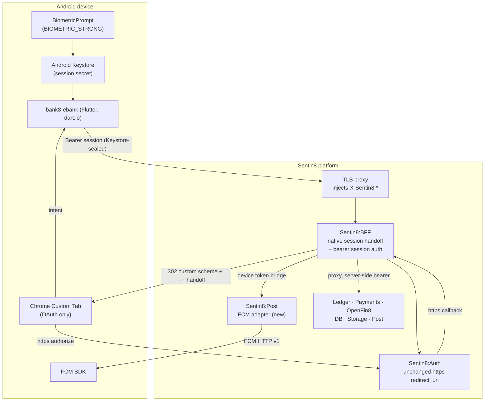
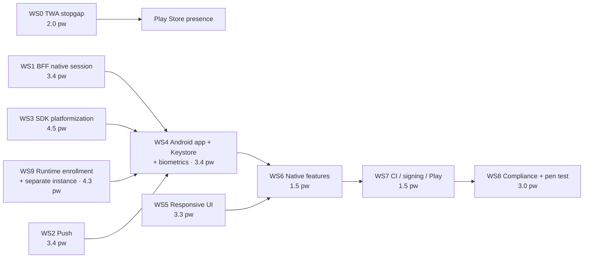

# Bank8:eBank — Android Program Design Docs

Status: **Draft for review**. No implementation has started.
Owner: eBank maintainers. Platform touchpoints: Sentin8:BFF, Sentin8:Post,
Sentin8:Flutter, Sentin8:CI.

This folder is the design record for delivering **bank8-ebank as a native
Android app** as a **separate app instance** from the existing Flutter web
build, with **runtime enrollment** (one APK, tenant origin discovered at first
run).

The web app's own design lives in [`../DESIGN.md`](../DESIGN.md); this set
describes only the mobile delta.

---

## 1. Locked decisions

| # | Decision | Consequence |
|---|---|---|
| D1 | **Auth = Option B** — a native session handoff in Sentin8:BFF | Auth stays an https-redirect-only confidential client; the app never holds an OAuth token |
| D2 | **Push in v1** | Requires a real FCM adapter in Sentin8:Post (today a stub) plus a push-token schema change in BFF |
| D3 | **Separate app instance** (`bank8-ebank-mobile`) | Own hostname, OAuth client, cookie domain, D2 binding, scope whitelist and listing. Mobile and web sessions cannot be swapped — D2 rejects it by construction. See [06-runtime-enrollment.md](06-runtime-enrollment.md) |
| D4 | **Biometric app-lock required** | `local_auth` + Keystore-bound session secret, not a UI-only gate |
| D5 | **TWA stopgap approved** | Ship a Trusted Web Activity inside ~2 weeks to get a Play Store presence; native work proceeds in parallel |
| D6 | **Runtime enrollment** (not per-org build flavors) | **One APK** for every customer tenant: no hostname or client id compiled in. Origin is established by QR / App Link at first run and persisted. See [06-runtime-enrollment.md](06-runtime-enrollment.md) |
| D7 | **`minSdk` 26** | `BiometricPrompt` + auth-bound Keystore keys are reliable from 26; covers ~98% of devices |
| D8 | **Mobile instance config mirrors the web instance** | Customer mode: `auth_domain` **empty**, `allow_signup: true`. Provisioned *without* `auth_url`. Setting it breaks sign-up in two places — see [06](06-runtime-enrollment.md) §3.4/§3.5 |
| D9 | **Public sign-up enabled** | Account opening is in scope on mobile; the Custom Tab must complete sign-up, and the Play account-deletion requirement applies |
| D10 | **Enrollment offers QR/App-Link *and* manual host entry** | Manual entry is treated as an **unverified** assurance tier with layered validation, explicit consent, and stepped-up biometric before sign-up. The runtime context is unsigned, so this cannot be verified — see [06](06-runtime-enrollment.md) §5.3 |
| D11 | **L2 uses bundled trust anchors**, not a remote list | The platform root is compiled in as a *trust anchor* (deployment config, not tenant identity — it names no org or instance). Custom-domain customers enroll by QR/App Link. A remote allow-list is rejected because a list fetched from an unverified host is self-certifying |
| D12 | **Play rollout is staged** | Internal → closed → 5/20/50/100% with gates between stages; no tag-triggered production publish. See [05](05-release-and-compliance.md) §4 |
| D13 | **One enrollment origin per install** | No multi-tenant profile switcher in v1. Switching tenant is an explicit sign-out + re-enroll, never a silent switch |

D3 and D6 interact: a separate instance gives the mobile app its own
`application_id`, so an enrollment to tenant A cannot be replayed against tenant
B's BFF, and the web↔mobile surfaces are isolated without extra work.

---

## 2. What the research established

Facts verified in the tree (not assumptions):

- The Flutter app **cannot compile for Android today**. `package:web` and
  `dart:js_interop` are imported unconditionally in 7 SDK files, and
  `dart run` on a `package:web` import fails with
  *"Dart library 'dart:js_interop' is not available on this platform."*
- There are **zero** `*.web.dart` / `*.io.dart` conditional imports in
  `sentin8-flutter`, despite its `DESIGN.md` claiming that pattern is used.
- BFF session auth is **cookie-only**: `proxy.rs::extract_session_cookie`
  reads the `bff-session` cookie and nothing else. There is no
  `Authorization` path.
- The session record is **JSON in Valkey**, not a Postgres row — adding fields
  needs no migration.
- `/auth/login` → Auth `/oauth/authorize` → `/auth/callback` → `Set-Cookie`
  works only because a browser is driving it. The callback's final hop is a
  302 to `q.state`.
- `NotificationSseClient.connect()` begins with `if (!kIsWeb) return;`, which
  also skips `startPolling()` — realtime is silently dead on Android, including
  the fallback.
- `POST /subscribe/push` already accepts a device token, but
  `sentin8-post`'s `"push"` channel handler is a `tracing::info!` stub.
- Auth already has an RFC 8628 device flow and RFC 8252 redirect helpers;
  **neither is used by this design** (see §4 of the auth doc for why).
- `flutter doctor` on this machine: Android SDK 36 present, `cmdline-tools`
  missing, licenses unaccepted.

---

## 3. Target architecture

The client still never sees an OAuth access or refresh token. It holds an
**opaque session token** — the same object a browser holds in a cookie — which
is exactly what keeps the `SECURITY.md` invariant intact.

---

## 4. Workstreams

| WS | Owner repo | Doc |
|---|---|---|
| WS0 | `bank8-ebank` (wrapper) | [04-android-app.md](04-android-app.md) |
| WS1 | `sentin8-bff` | [01-bff-native-session.md](01-bff-native-session.md) |
| WS2 | `sentin8-post` + `sentin8-bff` | [03-push-notifications.md](03-push-notifications.md) |
| WS3 | `sentin8-flutter` | [02-flutter-sdk-platformization.md](02-flutter-sdk-platformization.md) |
| WS4 | `bank8-ebank` | [04-android-app.md](04-android-app.md) |
| WS5 | `bank8-ebank` | [04-android-app.md](04-android-app.md) |
| WS6 | `bank8-ebank` | [04-android-app.md](04-android-app.md) |
| WS7 | `sentin8-ci` + `bank8-ebank` | [05-release-and-compliance.md](05-release-and-compliance.md) |
| WS8 | `bank8-ebank` | [05-release-and-compliance.md](05-release-and-compliance.md) |
| **WS9** | `bank8-ebank` + `sentin8-cli` | [06-runtime-enrollment.md](06-runtime-enrollment.md) |

**Effort**

| Scope | Workstreams | Effort | Calendar (2 devs) |
|---|---|---|---|
| Stopgap | WS0 | 2.0 pw | ~2 weeks |
| MVP | WS1, WS3–WS7, WS9 | 21.9 pw | ~14–15 weeks |
| Full | all | 30.3 pw | ~18–20 weeks |
| Solo | all | 30.3 pw | 7.5–8.5 months |

Critical path: **WS3, WS1 and WS9 in parallel** (three different repos, no
shared files).

### Effort reconciliation

The headline figures above are **derived from the per-workstream task tables**, not
estimated top-down. Revisions against the first-pass plan:

| WS | First pass | Detailed | Why it moved |
|---|---|---|---|
| WS5 | 5.0 pw | **3.3 pw** | ↓ The app has **zero** `DataTable` / `GridView`; layout is `Row`/`Column`/`Wrap` only, and there are just 3 meaningful fixed widths. No table-to-card redesign needed |
| WS3 | 3.5 pw | **4.5 pw** | ↑ `sentin8-flutter` has **no tests at all**. The conditional-import split is untestable without adding them, and they are needed regardless of Android |
| WS2 | 2.5 pw | **3.4 pw** | ↑ The Post channel is a `tracing::info!` stub, and the device token is currently dropped twice before it reaches the adapter — the FCM adapter plus its OAuth2 machinery is the real cost |
| WS1 | 3.0 pw | **3.4 pw** | ↑ Six duplicated session extractors to unify, plus the tenant-issuer refresh fix |
| WS8 | 2.5 pw | **3.0 pw** | ↑ D9 public sign-up makes an in-app account-closure path mandatory, and Ledger has no delete or close endpoint today |
| WS9 | — | **4.3 pw** | + New workstream created by the runtime-enrollment decision (D6), later extended by public sign-up (D9), manual-entry hardening (D10) and bundled trust anchors (D11). A per-org build would have cost ~0 now and more later |

Net: **21.9 pw MVP / 30.3 pw full**. Several increases are caused by decisions
taken after the first estimate (WS9 runtime enrollment, WS2 push-in-v1, WS8/D9
account closure, D10 manual entry, D11 anchors) and are not estimation error.
Treat the per-workstream tables as authoritative.

---

## 5. Sequencing rules

1. **WS3 first, and immediately.** Nothing app-side compiles until the SDK
   stops importing `package:web` unconditionally. It is independent of every
   other workstream and blocks WS4/WS5/WS6.
2. **WS1 before WS4.** The Android app needs an endpoint to redeem a handoff
   into a bearer session. WS1 is platform-side and has no app dependency.
3. **WS9 before WS4.** The app cannot bootstrap without a tenant origin, and
   runtime enrollment is the only way it obtains one (no hostname is compiled
   in). WS9 is independent of WS1 and WS3.
4. **WS0 in week 1–2.** It buys Play Store presence and de-risks store review
   (listing, data-safety form, privacy policy URL) while native work runs.
5. **WS5 last-ish.** The responsive pass wants the SDK stable; doing it before
   WS3 finishes means redoing layout work against moving widgets.
6. **WS2 can slip past MVP** if push becomes the only remaining delta. The
   app must not block sign-in or data on push registration succeeding.

---

## 6. Non-negotiable invariants

These extend `../DESIGN.md` §8 and `../SECURITY.md` to the mobile surface.

- No OAuth access token or refresh token is ever present in the app process,
  its storage, or its logs. The client holds an opaque session token only.
- The session token is persisted **only** inside Android Keystore-backed
  storage, sealed with `setUserAuthenticationRequired(true)` when biometric
  lock is enabled.
- Unknown app origin or failed runtime-context resolution is **fatal** — never
  a `localhost` or platform default. (Today's `_getCurrentHostname()` returns
  `'localhost'` on non-web; that default must not survive the port.)
- Every backend call goes through the BFF proxy. No direct service client, no
  direct Postgres, no direct storage SDK. `scripts/ci-guards.sh` gains Android
  paths but the rules are unchanged.
- The web build must remain byte-for-byte behaviourally identical after every
  WS3 step; `flutter build web` + the Playwright lifecycle suite is the
  regression gate.
- Custom-scheme deep links are used **only** for the OAuth handoff and
  statement/notification deep links; they carry single-use, short-lived codes,
  never credentials.
- **No tenant identity is compiled into the APK.** No hostname, no OAuth client
  id, no org name. The origin is established at enrollment and stored encrypted;
  WS8 greps the built artifact to prove it.
- **Enrollment origin is trustworthy by provenance, not by validation alone.** The
  pairing screen shows the org and instance name resolved from the runtime
  context *before* any credential is entered.

---

## 7. Decisions resolved and items deferred

Resolved on 2025-11-25. These supersede the first-pass recommendations.

| # | Question | Decision | Effect |
|---|---|---|---|
| O1 | One APK per org, or one APK with runtime enrollment? | **Runtime enrollment** (D6) | One APK; created WS9 |
| O2 | `minSdk` | **26** (D7) | Fixed in [04-android-app.md](04-android-app.md) §3.1 |
| O3 | Dedicated mobile app instance, or reuse the web instance? | **Separate instance**, narrower scope whitelist (D3) | New hostname + OAuth client + listing; see [06](06-runtime-enrollment.md) §3.2 |
| O4 | Play internal track only, or full production rollout in v1? | **Staged rollout** (D12) | Internal → closed → 5/20/50/100% with gates; see [05](05-release-and-compliance.md) §4 |
| O5 | QR-only enrollment, or QR + manual host entry? | **Both** (D10) | Manual entry is an unverified tier; see [06](06-runtime-enrollment.md) §5.3 |
| O6 | Does the mobile instance allow public sign-up? | **Yes** (D9) | Sign-up in scope; account closure required before production |
| O7 | Are custom-domain instances allowed to enroll manually? | **QR/App Link only** for custom domains (D11) | Manual entry accepts the bundled platform root; custom domains are refused with a clear message and a pointer to the bank's link |
| E4 | Multi-tenant profiles on one install? | **One origin per install** (D13) | Switching tenant = explicit sign-out + re-enroll; see [06](06-runtime-enrollment.md) §5.5 |

### Deferred to the platform backlog

| # | Item | Why deferred | Trigger to pull forward |
|---|---|---|---|
| PB-1 | **Sign `AppRuntimeContext`** (platform key + published JWKS) | It is a Sentin8:App change with its own key-management surface, not app work. Without it, manual enrollment can never exceed *informed consent* — see [06](06-runtime-enrollment.md) §5.3 | Raise alongside WS1. If manual-tier sign-up volume is material at closed-track review, pull it forward **before** the 5% stage |

No open questions remain for this programme.

---

## 8. Doc index

| Doc | Contents |
|---|---|
| [01-bff-native-session.md](01-bff-native-session.md) | WS1: handoff endpoints, `Session` additions, unified session extractor, revoke, threat model |
| [02-flutter-sdk-platformization.md](02-flutter-sdk-platformization.md) | WS3: file-by-file conditional-import plan, IO implementations, regression gate |
| [03-push-notifications.md](03-push-notifications.md) | WS2: push-token schema, BFF bridge changes, Post FCM adapter, device lifecycle |
| [04-android-app.md](04-android-app.md) | WS0/WS4/WS5/WS6: TWA stopgap, Android scaffold, Keystore + biometrics, responsive UI, native features |
| [05-release-and-compliance.md](05-release-and-compliance.md) | WS7/WS8: CI lane, signing, Play rollout, security checklist deltas, pen-test scope |
| [06-runtime-enrollment.md](06-runtime-enrollment.md) | **WS9:** discovery gap, QR/App-Link enrollment, separate mobile instance, mobile scope whitelist, provisioning |
